# **Research Log**

**Author:** Kaitlyn Hill  
**Faculty Advisor:** Dr. Trace Martyn  
**Lab:** Martyn Ecology at Oregon State University

---

## **Table of Contents**

- [1. Introduction](#1-project-overview)
    - [1.1 Dissertation Background](#11-dissertation-background)
    - [1.2 Initial Project Directions](#12-initial-project-directions)
    - [1.3 Research Direction Evolution](#13-research-direction-evolution)
- [2. Data](#2-data)
    - [2.1 Individual Trait Data](#21-individual-trait-data)
    - [2.2 Plot Condition Data](#22-plot-condition-data)
    - [2.3 Seed Production Data](#23-seed-production-data)
    - [2.4 Species Information Data](#24-species-information-data)
- [3. Model 0 - Bud Production: Environmental Predictors](#3-model-0---bud-production-environmental-predictors)
    - [3.1 Research Question](#31-research-question)
    - [3.2 Data Preparation](#32-data-preparation)
    - [3.3 Data Exploration](#33-data-exploration)
    - [3.4 Predictors](#34-predictors)
    - [3.5 Model Approach](#35-model-approach)
    - [3.6 Results](#36-results)
    - [3.7 Interpretation](#37-interpretation)
    - [3.8 Discussion / Next Steps](#38-discussion--next-steps)
- [4. Model 1 - Seed Production](#4-model-1---seed-production)
    - [4.1 Research Question](#41-research-question)
    - [4.2 Data Preparation](#42-data-preparation)
    - [4.3 Data Exploration](#43-data-exploration)
    - [4.4 Predictors](#44-predictors)
    - [4.5 Model Approach](#45-model-approach)
    - [4.6 Results](#46-results)
    - [4.7 Interpretation](#47-interpretation)
    - [4.8 Discussion / Next Steps](#48-discussion--next-steps)
- [5. Model 2 — Seed Production: Family Groups + Environment](#5-model-2--seed-production-family-groups--environment)
    - [5.1 Research Question](#51-research-question)
    - [5.2 Data](#52-data)
    - [5.3 Predictors](#53-predictors)
    - [5.4 Model Approach](#54-model-approach)
    - [5.5 Results](#55-results)
    - [5.6 Interpretation](#56-interpretation)
    - [5.7 Discussion / Next Steps](#57-discussion--next-steps)
- [6. Model 3 — Seed Production: Individual Species](#6-model-3--seed-production-individual-species)
    - [6.1 Research Questions](#61-research-question)
    - [6.2 Data](#62-data)
    - [6.3 Predictors](#63-predictors)
    - [6.4 Model Approach](#64-model-approach)
    - [6.5 Results](#65-results)
        - [6.5.1 Model 3a - VERO](#651-model-3a---vero)
        - [6.5.2 Model 3b - ARCA](#652-model-3b---arca)
        - [6.5.3 Model 3c - PEAI](#653-model-3c---peai)
        - [6.5.4 Model 3d - POCA](#654-model-3d---poca)
        - [6.5.5 Comparison Across Species](#655-comparison-across-species)
    - [6.6 Discussion / Next Steps](#66-discussion--next-steps)
- [7. Model 4 — Ecological Predictor Exploration and Evaluation](#7-model-4---ecological-predictor-exploration-and-evaluation)
    - [7.1 Research Question](#71-research-question)
    - [7.2 Data](#72-data)
    - [7.3 Predictors](#73-predictors)
        - [7.3.1 Original Environmental Predictors](#731-original-environmental-predictors)
        - [7.3.2 Additional Ecological Predictors](#732-additional-ecological-predictors)
    - [7.4 Model Approach](#74-model-approach)
    - [7.5 Results](#75-results)
        - [7.5.1 Seed Distribution and Outliers](#751-seed-distribution-and-outliers)
        - [7.5.2 Relationships between Predictors and Seed Production](#752--relationships-between-predictors-and-seed-production)
        - [7.5.3 Predictor Group Comparison](#753-predictor-group-comparison)
        - [7.5.4 Prediction Errors and High-Seed Observations](#754-prediction-errors-and-high-seed-observations)
        - [7.5.5 Predictor Importance](#755-predictor-importance)
    - [7.6 Interpretation](#76-interpretation)
    - [7.7 Discussion / Next Steps](#77-discussion--next-steps)
- [8. Model 5 — Alternative Machine Learning Approaches](#8-model-5---alternative-machine-learning-approaches)
    - [8.1 Research Question](#81-research-question)
    - [8.2 Data](#82-data)
    - [8.3 Predictors](#83-predictors)
    - [8.4 Model Approach](#84-model-approach)
    - [8.5 Results](#85-results)
        - [8.5.1 Model 5a - Random Forest (Squared Error)](#851-model-5a---random-forest-squared-error)
        - [8.5.2 Model 5b - Random Forest (Poisson)](#852-model-5b---random-forest-poisson)
        - [8.5.3 Model 5c - Negative Binomial Regression](#853-model-5c---negative-binomial-regression)
        - [8.5.4 Model 5d - Linear Regression](#854-model-5d---linear-regression)
        - [8.5.5 Model 5e - Gradient Boosting](#855-model-5e---gradient-boosting)
        - [8.5.6 Model 5f - Extra Trees](#856-model-5f---extra-trees)
        - [8.5.7 Model 5g - K-Nearest Neighbors](#857-model-5g---k-nearest-neighbors)
        - [8.5.8 Model Comparison](#858-model-comparison)
    - [8.6 Interpretation](#86-interpretation)
    - [8.7 Discussion / Conclusion](#87-discussion--conclusion)

 

---
## **1. Project Overview**

### **1.1 Dissertation Background**
Dr. Martyn’s research examined how plant species interact with each other and their environment. Her work focused on how these interactions influence plant competition, community structure, and reproductive success.

An important part of the dissertation was the study of higher-order interactions. Plant interactions are not always limited to the effects of one species on another. Instead, the presence of additional species can change how two species interact. This means that plant performance may depend on the larger community surrounding an individual.

The datasets collected during this research include information on individual plants, species identity, reproductive output, environmental conditions, and plant locations within plots. These datasets provide several ways to examine the factors associated with plant performance.

The goal of this project was to use these existing datasets in a new way. Rather than repeating the analyses from the dissertation, the project explores new ways to analyze the large quantity of data.

### **1.2 Initial Project Directions**
Several potential research directions were considered for analyzing the dissertation data:

- Spatial / point-pattern analysis: Use mapped plant locations to investigate clustering, competition, neighboring species, and whether spatial relationships were associated with reproductive success.
- Long-term population analysis: Use the long-term seed-bank dataset to examine changes in species abundance and population dynamics over time, potentially using time-series or population-growth models such as Ricker models.
- Machine-learning prediction: Develop a model that uses environmental and biological variables to predict some measure of plant success or reproductive output and identify which variables contribute most strongly to predictions.
- Species interactions and biological groupings: Explore whether species interactions or broader classifications, such as functional or taxonomic groups, could help explain differences in plant performance.

### **1.3 Research Direction Evolution**
The project focused on using machine-learning approaches to investigate patterns in plant reproductive output and evaluate how accurately reproductive success could be predicted from environmental and ecological characteristics.

The analysis initially examined bud production using environmental predictors. However, limitations in the available bud data led to a transition toward seed production, which provided a substantially larger dataset across more species and plots.

Early models investigated whether environmental conditions, species identity, and broader taxonomic groupings could predict seed production in previously unseen plots. Limited predictive performance led to a more focused investigation of individual species, particularly VERO, which was well represented in the dataset and was a primary species of interest in the original dissertation.

The later stages expanded the predictors to include ecological characteristics such as species diversity and plant functional composition. The evaluation strategy also shifted from emphasizing generalization to unseen plots toward predicting individual VERO observations within the sampled plot population. Finally, alternative machine-learning and regression approaches were compared to determine whether algorithm selection could improve predictive performance.

Throughout these stages, the research evolved from broad predictions of plant reproductive output toward a more focused investigation of the environmental and ecological characteristics associated with individual VERO seed production.

--- 
## **2. Data**

### **2.1 Individual Trait Data**

**Original file:** `TRAIT.DATA.10.06.2017.csv` 
**Cleaned file:** `buds.csv`  
**Contains:** Individual plant observations, including plot and species identification, reproductive measurements (buds, flowers, and fruits), and plant traits such as height, shape, and phenology.  
**Used For:** Initial exploration of bud production and the first machine-learning model (Model_0)  
**Cleaning performed:**
- Removed observations with missing bud counts.
- Removed all entries that weren’t taken in 2016 (the 2017 entries)
- Removed all POLE species data entries due to insufficient data (only 2 entries)
- Fixed small date entry errors (process date was recorded a decade in the future)
- Began with **1,387** entries, cleaned to **1,270**

### **2.2 Plot Condition Data**

**Original file:** `Plot.DATA.06.09.2017.csv`  
**Cleaned file:** `plots.csv`  
**Contains:** Plot-level environmental, spatial, and community information for the 100 study plots. This includes plot location and identification, vegetation cover, soil phosphorus levels, canopy cover, plant density and diversity, and spatial coordinates/distances.  
**Used for:** Provides the plot-level environmental predictors used in the machine-learning models and can be connected to the biological datasets using their corresponding plot identifiers.  
**Cleaning performed:**
- No needed data cleaning
- The file was renamed for easier identification and use in Python analyses
- **100 entries**, one for each plot

### **2.3 Seed Production Data**

**Original file:** `Plant.Level.Seed.Count.30.6.2018.csv`  
**Cleaned file:** `seeds.csv`  
**Contains:** Individual seed collection observations, including plot and species identification, collection dates, seed counts, reproductive measurements, and data-quality notes.  
**Used for:** Primary biological dataset for the seed-production analysis. Seed number (`Num.Seed`) became the measure of reproductive output after the bud dataset was determined to have insufficient data for the larger machine-learning analysis.  
**Cleaning performed:**
- Removed non-numeric entries such as 'N/A', ' . ', and blank values
- Removed eight unidentified species entries
- Converted relevant variables to numeric values for analysis
- Began with **16,963** entries, cleaned to **13,485**

### **2.4 Species Information Data**

**Original file:** `species_data.csv`  
**Altered file:** `species_data_TEM_2026.csv`  
**Cleaned file:** `species.csv`  
**Contains:** Species-level information, including species name, species code, life form, exotic status, taxonomic family, reserve occurrence, and additional notes  
**Used for:** Providing taxonomic information for Model 2, where species were grouped by family, and supporting the development of additional ecological predictors in Model 4, including plant functional composition, family composition, and native/exotic species characteristics.  
**Cleaning performed:**
- Missing taxonomic information was placed into a new csv file (`species_data_TEM_2026.csv`)
- Matching species information was consolidated into a cleaned csv file (`species.csv`) for use in subsequent analyses.

---
## **3. Model 0 - Bud Production: Environmental Predictors**

### **3.1 Research Question**
Can plot-level environmental conditions be used to predict bud production at the individual plant level?

The purpose of Model 0 was to establish an initial machine-learning approach for examining whether environmental variation among plots could explain differences in plant reproductive output.

### **3.2 Data Preparation**
Model 0 used individual plant observations from `buds.csv` combined with plot-level environmental data from `plots.csv`. 
 The datasets were joined using: `buds["ID"]` → `plots["Name"]`

The final dataset used for Model 0 contained:
- **1,270 individual plant observations**
- **50 plots**
- **4 species:** ARCA, PEAI, POCA, and VERO
- **Response variable:** `buds`

**Data cleaning note:** An earlier version of the cleaned dataset contained 1,260 observations and produced a mean R² of -0.153. During data review, 10 observations were found to contain incorrect year entries and were restored, resulting in the final dataset of **1,270** observations.

### **3.3 Data Exploration**
Exploratory analysis was conducted to examine species representation and differences in bud production before developing Model 0.

Bud production among the four species:

| Species | Plant Count | Total Buds |Mean Buds per Plant |
| --- | --- | --- | ---: |
| ARCA | 272 | 636 | 2.34 |
| PEAI | 355 | 91 | 0.26 |
| POCA | 329 | 510 |1.55 |
| VERO | 314 | 2320 | 7.39 |

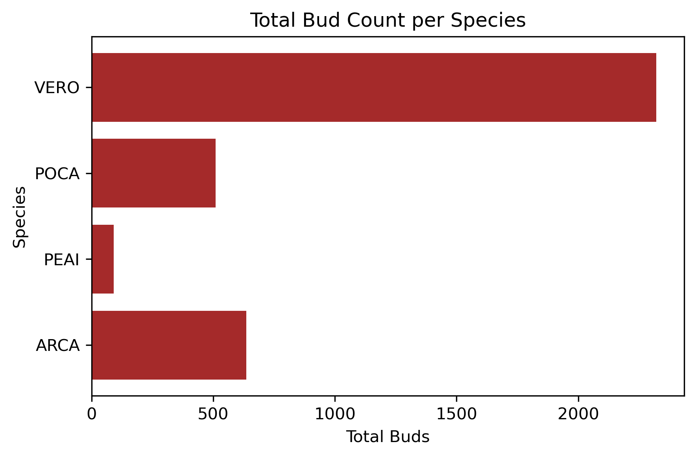

The exploratory results showed substantial differences in bud production among the four species. Although observation counts were relatively similar among the four species, total and mean bud production varied considerably among species. This variation suggested that species identity could potentially account for some of the differences in individual reproductive output.

Bud production was also examined across plots where bud production varied considerably.

### **3.4 Predictors**
Six plot-level environmental variables were selected as predictors:

- `Per.Litt` — percent litter cover
- `Per.Bare` — percent bare ground
- `Per.Woody` — percent woody cover
- `Soil.P` — soil phosphorus
- `Soil.Water` — soil water
- `Canopy.Cover` — canopy cover

Species identity was **not** included as a predictor in Model 0. The purpose of this initial model was to determine how well environmental conditions alone could predict individual bud production.

### **3.5 Model Approach**
A **Random Forest Regressor** was used to predict the number of buds produced by each individual plant.

Model performance was evaluated using **5-fold GroupKFold cross-validation**, with observations grouped by plot. This kept all observations belonging to the same plot within the same fold and prevented the model from being trained and tested on individuals experiencing the same plot-level environmental conditions.

This approach was used to evaluate how well the model could predict bud production in plots that were not included in the training data.

Model performance was evaluated using:

- **R²** — measure of predictive performance relative to predicting the mean, with higher values indicating better model performance
- **MAE** — mean absolute difference between observed and predicted bud counts
- **RMSE** — measure of prediction error that gives greater weight to larger errors

Random Forest feature importance was also used to compare the relative contribution of the six environmental predictors.

### **3.6 Results**

| Model Performance | |
| --- | ---:|
| Mean R² | -0.052 |
| Mean MAE | 3.13 buds |
| Mean RMSE | 4.98 buds |

The negative mean R² (-0.052) indicates that the model performed poorly when predicting bud production in unseen plots and did not outperform a simple baseline prediction based on the mean. Across cross-validation folds, predictions differed from observed bud counts by an average of approximately 3.13 buds (MAE), while the RMSE of 4.98 buds indicates that larger prediction errors were also present.

#### Feature importance

| Variable | Importance |
| --- | ---: |
| Soil.P | 0.270 |
| Per.Bare | 0.223 |
| Per.Woody | 0.199 |
| Canopy.Cover | 0.134 |
| Soil.Water | 0.122 |
| Per.Litt | 0.051 |

Soil phosphorus had the highest feature importance (0.270), followed by percent bare ground (0.223) and percent woody cover (0.199). Together, these variables contributed the most to the Random Forest model’s predictions of bud production. Canopy cover (0.134) and soil water (0.122) showed moderate importance, while percent litter cover had the lowest feature importance (0.051). Overall, the model relied more heavily on soil phosphorus and ground-cover characteristics than on the other environmental predictors.

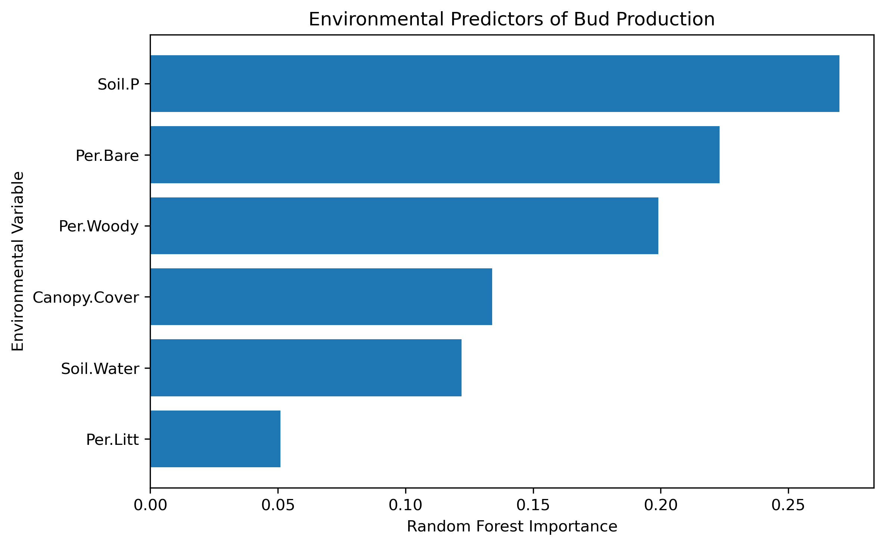

### **3.7 Interpretation**
Overall, Model 0 had poor predictive performance. The negative mean R² indicates that the six environmental predictors alone were not sufficient to accurately predict individual bud production in plots excluded from model training.

Although soil phosphorus, percent bare ground, and percent woody cover had the highest feature importance values, these values should be interpreted cautiously because of the model's poor overall predictive performance. Feature importance identifies which variables the Random Forest relied on most when making predictions, but does not necessarily indicate that those variables have strong ecological effects on bud production.

The exploratory analysis also showed considerable differences in bud production among species. Because species identity was not included as a predictor in Model 0, some of the unexplained variation in bud production may be associated with differences among species rather than the measured environmental conditions alone.

### **3.8 Discussion / Next Steps**
Model 0 established an initial framework for predicting reproductive output from plot-level environmental conditions. However, its results also highlighted several limitations of the bud dataset that affected the direction of subsequent models.

Several limitations were identified:

- The bud dataset contained only **1,270** usable observations across **50 plots**.
- Only four species were sufficiently represented in the dataset.
- Bud production varied substantially among species, but species identity was not included in Model 0.
- The environmental predictors alone were not sufficient to accurately predict bud production in unseen plots.

Given the observed differences in bud production among species, incorporating species identity as an additional predictor was considered the logical next step for improving Model 0. This would have allowed the model to account for species-level differences in reproductive output rather than relying solely on environmental conditions. However, the relatively small number of observations, limited species representation, and coverage of only 50 plots restricted the amount of information available for developing and evaluating a more complex species-inclusive bud model. As a result, this extension was considered but was not pursued further with the bud dataset.

A larger seed-production dataset (`seeds.csv`) was available that contained substantially more observations, represented more species, and covered all 100 plots. Seed production also provided an alternative measure of reproductive output that could be analyzed using the same general machine-learning framework.

Based on these limitations, the project shifted from bud production to seed production as the primary response variable. The next model, Model 1, used `Num.Seed` as the response and expanded the predictor set to include species identity alongside the environmental variables. This transition allowed the analysis to test whether accounting for differences among species could improve predictions of reproductive output while retaining the environmental predictors examined in Model 0.

---
## **4. Model 1 - Seed Production**

### **4.1 Research Question**
Can seed production at the individual observation level be predicted using species identity and plot-level environmental conditions?

Model 1 applies the machine-learning framework established in Model 0 to the larger seed-production dataset. Unlike Model 0, which examined bud production, Model 1 uses seed production as the response variable and incorporates species identity alongside plot-level environmental predictors.

### **4.2 Data Preparation**
Model 1 used seed-production data from `seeds.csv` and plot-level environmental data from `plots.csv`. 
 The seed and plot datasets were joined using: `seeds["Plot.ID"]` → `plots["Plot"]`

The response variable was:
- `Num.Seed` - Number of seeds recorded for an observation

The final dataset used for Model 1 contained:

- **13,485 observations**
- **100 plots**
- **70 species**

### **4.3 Data Exploration**

Exploratory analysis examined species representation and differences in seed production before developing Model 1.

#### Overall Seed Distribution
Seed production was highly variable across the dataset.

| Statistic | Seeds |
| --- | ---: |
| Mean | 64.12 |
| Standard Deviation | 173.62 |
| Minimum | 0 |
| 25th Percentile | 7 |
| Median | 20 |
| 75th Percentile | 52 |
| Maximum | 5,830 |

The mean seed count (64.12) was substantially greater than the median (20), and the maximum observation reached 5,830 seeds. This indicates a strongly right-skewed distribution in which most observations had relatively low seed counts while a smaller number of observations had very high seed production.

A total of **1,014 observations (7.52%)** recorded zero seeds.
Total seed production was also examined across plots:

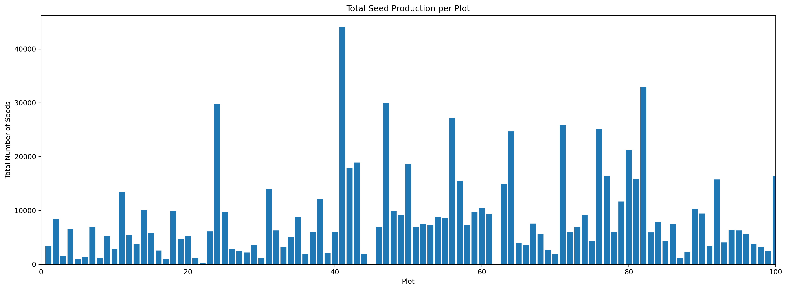

Total seed production varied substantially among plots, with several plots producing considerably more seeds than others. This variation provided an initial indication that seed production was unevenly distributed across the study plots.

Because 70 species were represented in the modeling dataset, the seven most frequently observed species are summarized below:

| Species | Observations | Total Seeds | Mean Seeds | Median Seeds | Std | Min Seeds | Max Seeds |
| --- | --- | --- | --- | --- | --- | --- | ---: |
| VERO | 3027 | 55915 | 18.47 | 14.0 | 20.12 | 0 | 184 |
| ARCA | 2515 | 88710 | 35.27 | 15.0 | 84.07 | 0 | 1386 |
| PEAI | 2485 | 372236 | 149.79 | 60.0 | 281.32 | 0 | 5830 |
| POCA | 943 | 134647 | 142.79 | 73.0 | 213.55 | 0 | 2480 |
| PLDE | 478 | 19107 | 39.97 | 32.0 | 35.31 | 0 | 238 |
| PTGA | 465 | 9137 | 19.65 | 12.0 | 25.06 | 0 | 192 |
| HYGL | 376 | 9258 | 24.62 | 15.0 | 38.67 | 0 | 387 |

VERO, ARCA, and PEAI were particularly well represented, with more than 2,400 observations each. In contrast, many species had relatively few observations, including several species represented by only one or two observations.

Seed production also differed substantially among species. For example, PEAI averaged **149.79 seeds per observation**, while VERO averaged **18.47** despite having the largest number of observations. POCA also had relatively high seed production, averaging **142.79 seeds** per observation. These differences in seed production among species suggested that species identity could account for some of the variation not captured by plot-level environmental conditions alone.

### **4.4 Predictors**
Model 1 included both biological and environmental predictors.

Species identity was included as a categorical predictor:

- `Species`

The same six plot-level environmental predictors examined in Model 0 were retained:

- `Per.Litt` - Percent litter cover
- `Per.Bare` - Percent bare ground
- `Per.Woody` - Percent woody cover
- `Soil.P` - Soil phosphorus
- `Soil.Water` - Soil water
- `Canopy.Cover` - Canopy cover

Because species identity is categorical, it was one-hot encoded into separate species-specific predictor variables for use in the Random Forest model.

### **4.5 Model Approach**
A **Random Forest Regressor** was used to predict `Num.Seed` using species identity and the six environmental predictors.

Model performance was evaluated using **5-fold GroupKFold cross-validation**, with observations grouped by plot. All observations from the same plot were therefore kept within the same fold. This allowed model performance to be evaluated on plots that were not included in the corresponding training data.

Performance was evaluated using:
- **R²** — proportion of variation in seed production explained by the model
- **MAE** — mean absolute difference between observed and predicted seed counts
- **RMSE** — measure of prediction error that gives greater weight to larger errors

Random Forest feature importance was also calculated to examine the relative contribution of species identity and environmental conditions to model predictions.

### **4.6 Results**

#### Model Performance

| Metric | Value |
| --- | ---: |
| Mean R² | -0.012 |
| Mean MAE | 76.28 seeds |
| Mean RMSE | 172.18 seeds |

The mean R² was close to zero but remained negative, indicating that the model had poor predictive performance when predicting seed production in unseen plots.

The RMSE was substantially larger than the MAE, indicating that some observations had particularly large prediction errors.

#### Feature Importance
The Random Forest model contained **76 predictors** after species identity was encoded alongside the six environmental variables.

The highest-ranking predictors included:

| Variable | Importance |
| --- | ---: |
| Soil.Water | 0.218 |
| Soil.P | 0.185 |
| Per.Bare | 0.111 |
| PEAI | 0.107 |
| Per.Litt | 0.098 |

Soil water had the highest feature importance, followed by soil phosphorus. `PEAI` was the highest-ranking species-specific predictor and was the fourth most important predictor overall.

Some species-specific predictors contributed very little to the model. Among the lowest feature importance values were `ERLO`, `AVBA`, `GR.HUGE`, `PTGA.YEL`, and `EMAU`.

For visualization clarity, only predictors with a Random Forest feature importance greater than 0.015 are displayed.

### **4.7 Interpretation**
Model 1 had limited predictive ability, with a mean R² of -0.012. The negative R² indicates that the model did not generalize well when predicting seed production in unseen plots.

The large difference between the MAE and RMSE suggests that some observations had particularly large prediction errors. This is consistent with the wide range in seed production, which extended from 0 to 5,830 seeds.

Species identity also contributed to model predictions, with Species_PEAI ranking as the highest species-specific predictor and fourth-highest predictor overall. However, species representation within the dataset was highly uneven. Some species contained substantially more observations than others, which may influence the contribution of individual species variables to the model.

The feature importance results also suggest that environmental conditions remained relevant to model predictions. Soil water and soil phosphorus were the two highest-ranking predictors. However, because overall predictive performance remained poor, feature importance should be interpreted cautiously and should not be considered evidence of direct ecological effects.

### **4.8 Discussion / Next Steps**
Although adding species identity provided more biological information than Model 0, Model 1 still had limited predictive ability. The model also introduced a new challenge: representing a large number of individual species as separate predictors.

With 70 species represented in the dataset, species differed considerably in the number of available observations and in their seed production. Treating every species independently may therefore create a large number of species-specific predictors without capturing biological similarities among them.

Potential next steps included exploring alternative ways to represent species-level variation. These included:

- Grouping species according to broader biological or taxonomic characteristics
- Examining species diversity and composition within plots
- Exploring species-level effect sizes relative to typical seed production
- Focusing additional analyses on selected species with sufficient representation and known ecological characteristics

The next model therefore investigates whether species can be represented using broader biological groupings rather than treating each species as completely independent.

---
## **5. Model 2 — Seed Production: Family Groups + Environment**

### **5.1 Research Question**
Can seed production at the individual observation level be predicted using taxonomic family and plot-level environmental conditions?

Model 2 builds on Model 1 by replacing individual species identity with broader taxonomic family groups. Model 1 represented each of the 70 species as an independent categorical predictor, while Model 2 groups species that belong to the same taxonomic family. This approach investigates whether broader taxonomic relationships can represent biological variation in seed production while reducing the number of categorical predictors included in the model.

### **5.2 Data**
Model 2 used seed-production data from `seeds.csv`, taxonomic information from `species.csv`, and plot-level environmental data from `plots.csv`.

Species information was matched to the species represented in the seed-production dataset during previous data preparation. Known differences in species identifiers between the original seed and species-information datasets were standardized before creation of `species.csv`.

One unidentified species code, `UK.GRASS`, did not have corresponding taxonomic information and was excluded from Model 2. This resulted in the removal of 4 observations from the Model 1 dataset.

The seed and species datasets were joined using: 
`seeds["Species"]` → `species["Species"]`

The seed and plot datasets were joined using:  
`seeds["Plot.ID"]` → `plots["Plot"]`

The response variable was:
- `Num.Seed` - Number of seeds recorded for an observation

The final dataset used for Model 2 contained:

- **13,481 observations**
- **100 plots**
- **22 taxonomic families**

### **5.3 Predictors**
Model 2 included both taxonomic and environmental predictors.

Taxonomic family was included as a categorical predictor:  
- `family`

The same six plot-level environmental predictors examined in Models 0 and 1 were retained:

- `Per.Litt` - Percent litter cover
- `Per.Bare` - Percent bare ground
- `Per.Woody` - Percent woody cover
- `Soil.P` - Soil phosphorus
- `Soil.Water` - Soil water
- `Canopy.Cover` - Canopy cover

Because taxonomic family is categorical, it was one-hot encoded into separate family-specific predictor variables for use in the Random Forest model.

After one-hot encoding, the model contained **28 predictors**: 22 family-level predictors and six environmental predictors.

### **5.4 Model Approach**
A **Random Forest Regressor** was used to predict `Num.Seed` using taxonomic family and the six environmental predictors.

The modeling framework was kept consistent with Model 1 so that the effect of changing the biological grouping could be evaluated while maintaining the same general modeling approach.

Model performance was evaluated using **5-fold GroupKFold cross-validation**, with observations grouped by plot. All observations from the same plot were therefore kept within the same fold. This allowed model performance to be evaluated on plots that were not included in the corresponding training data.

Performance was evaluated using:

- **R²** — proportion of variation in seed production explained by the model
- **MAE** — mean absolute difference between observed and predicted seed counts
- **RMSE** — measure of prediction error that gives greater weight to larger errors

Random Forest feature importance was also calculated and averaged across the cross-validation folds to examine the relative contribution of taxonomic family and environmental conditions to model predictions.

Because the response variable, environmental predictors, modeling algorithm, and cross-validation strategy were kept consistent with Model 1, Model 2 provides a direct comparison between representing biological variation using individual species and broader taxonomic families.

### **5.5 Results**

| Metric | Value |
| --- | ---: |
| Mean R² | -0.153 |
| Mean MAE | 83.29 seeds |
| Mean RMSE | 182.92 seeds |

The mean R² was negative, indicating that Model 2 had poor predictive performance when predicting seed production in unseen plots.

The RMSE was substantially larger than the MAE, indicating that some observations had particularly large prediction errors. This pattern was also observed in Model 1 and is consistent with the highly variable and right-skewed distribution of seed production.

#### **Feature Importance**

The Random Forest model contained **28 predictors** after the 22 taxonomic families were encoded alongside the six environmental variables.

The highest-ranking predictors included:

| Variable | Importance |
| --- | ---: |
| Per.Bare | 0.204 |
| Soil.P | 0.197 |
| Soil.Water | 0.160 |
| Canopy.Cover | 0.117 |
| Poaceae | 0.114 |
| Per.Litt | 0.084 |
| Asteraceae | 0.042 |
| Per.Woody | 0.034 |

Environmental variables accounted for most of the highest-ranking predictors. Percent bare ground had the highest feature importance, followed by soil phosphorus and soil water.

`Poaceae` was the highest-ranking family-level predictor and the fifth most important predictor overall, with a feature importance of 0.114. `Asteraceae` was the next highest-ranking family at 0.042. Most other family-level predictors had substantially lower feature importance.

### **5.6 Interpretation**
Model 2 had poor predictive performance, with a mean R² of -0.153. Performance was also worse than Model 1, which had a mean R² of -0.012. This suggests that grouping species by taxonomic family did not improve the model's ability to predict seed production in unseen plots.

Environmental variables remained the highest-ranking predictors, particularly percent bare ground, soil phosphorus, and soil water. Poaceae was the highest-ranking family predictor, while most other families had relatively low feature importance.

Grouping species by family may remove important differences among individual species. Although species within the same family are taxonomically related, they may still differ substantially in seed production and their responses to environmental conditions.

### **5.7 Discussion / Next Steps**
Model 2 reduced the number of biological categories from 70 species to 22 families, but this simplification did not improve predictive performance. Grouping species into broader taxonomic categories may have removed some of the species-level differences that are important for understanding variation in seed production.

The results from Models 1 and 2 suggest that combining many species within a single model may not be the most effective approach. Species vary considerably in both their number of observations and their seed production, which may make it difficult for a single model to represent these differences.

Model 3 will therefore focus on the most frequently recorded species and model each species separately. Prioritizing species with the largest number of observations will provide more data for training and evaluating each species-specific model.

This approach will remove differences among species from within each model and allow Model 3 to focus specifically on whether plot-level environmental conditions can predict variation in seed production within individual species. Model performance and feature importance can then be compared across the selected species.

---
## **6. Model 3 — Seed Production: Individual Species**

### **6.1 Research Question**

Can plot-level environmental conditions better predict seed production when models are restricted to individual, well-represented species?

Model 3 investigates seed production separately within individual species. By removing variation associated with species identity, these models examine whether environmental conditions can predict seed production more effectively within a single species. The models also allow environmental feature importance to be compared across species.

The analysis was conducted using four species-specific models. **Model 3a** focused on **VERO**, the most frequently represented species in the seed dataset and an original focus of the dissertation. The same modeling approach was then independently applied to **ARCA (Model 3b), PEAI (Model 3c), and POCA (Model 3d)**. These were the next three most frequently represented species in the dataset.

Model 3 is framed to investigate two questions:
1. How well does the Random Forest predict seed production for each species?
2. Does the relative importance of environmental predictors differ among VERO, ARCA, PEAI, and POCA?

### **6.2 Data**
Model 3 used the same cleaned seed-production and plot-level environmental datasets used for Model 1.

The response variable remained:

- `Num.Seed` — number of seeds recorded for an observation

The expanded analysis included separate models for the four most frequently represented species:

| Species | Observations | Number of Plots | 
| --- | --- | ---: |
| VERO | 3,027 | 46 |
| ARCA | 2,515 | 61 |
| PEAI | 2,485 | 74 |
| POCA | 943 | 71 |

Together, these four species accounted for 8,970 of the 13,485 observations in the full seed dataset.

Restricting the analysis to these species allowed environmental relationships to be examined within individual species while retaining substantially larger sample sizes than were available for most other species in the dataset.

### **6.3 Predictors**
Model 3 used the same six plot-level environmental predictors examined in Models 0 and 1:

- `Per.Litt` — percent litter cover
- `Per.Bare` — percent bare ground
- `Per.Woody` — percent woody cover
- `Soil.P` — soil phosphorus
- `Soil.Water` — soil water
- `Canopy.Cover` — canopy cover

Species identity was not included as a predictor because each model was restricted to observations from a single species. This allowed Model 3 to focus specifically on whether variation in environmental conditions could explain differences in seed production within each species.

### **6.4 Model Approach**
A **Random Forest Regressor** was used to predict `Num.Seed` from the six environmental predictors.

Four separate models were created for the selected species:
- Model 3a — VERO
- Model 3b — ARCA
- Model 3c — PEAI
- Model 3d — POCA

Each species was modeled independently using the same environmental predictors and modeling procedure.

Model performance was evaluated using **5-fold GroupKFold cross-validation**, with observations grouped by plot. This ensured that observations from the same plot were kept together during training and testing.

Model performance was evaluated using:

- **R²** — proportion of variation in seed production explained by the model
- **MAE** — mean absolute difference between observed and predicted seed counts
- **RMSE** — measure of prediction error that gives greater weight to larger errors

Random Forest feature importance was also calculated separately for each species. This allowed both model performance and the relative importance of environmental predictors to be compared among VERO, ARCA, PEAI, and POCA.

### **6.5 Results**

#### **6.5.1 Model 3a - VERO**
VERO was represented by **3,027 observations across 46 plots**. However, observations were unevenly distributed among plots, with several plots containing substantially more VERO observations than others.

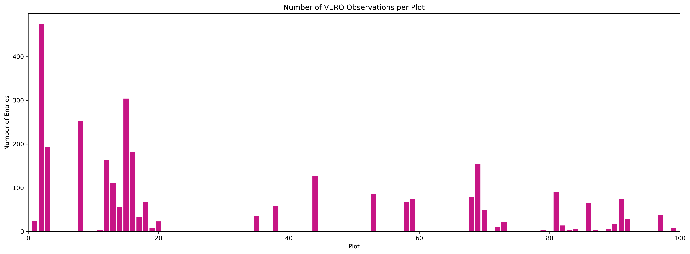

Total VERO seed production also varied considerably among plots. Plots with greater numbers of VERO observations generally contributed larger total seed counts, although the relationship was not uniform. This suggests that differences in total seed production among plots reflect both variation in the number of sampled plants and variation in seed production among individual plants.

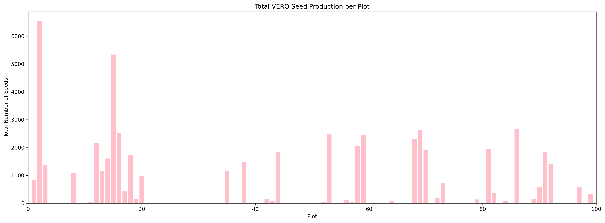

#### Model Performance

| Metric | Value |
| --- | ---: |
| Mean R² | -0.366 |
| Mean MAE | 18.13 seeds |
| Mean RMSE | 22.92 seeds |

The VERO-specific Random Forest showed poor predictive performance. The mean cross-validated R² was **−0.366**, indicating that predictions on held-out plots performed worse than a simple baseline based on the mean seed count. The model had a mean absolute error of **18.13 seeds** and a root mean squared error of **22.92 seeds**.

These results suggest that the six plot-level environmental variables included in the model were not sufficient to reliably predict individual VERO seed production across plots.

#### Feature importance

| Variable | Importance |
| --- | ---: |
| Canopy.Cover | 0.545 |
| Soil.Water | 0.156 |
| Per.Litt | 0.095 |
| Soil.P | 0.087 |
| Per.Bare | 0.079 |
| Per.Woody | 0.038 |

Canopy cover had the greatest feature importance (0.545), accounting for more than half of the total Random Forest importance. Soil water was the second most important predictor (0.156), while the remaining environmental variables had substantially lower importance values.

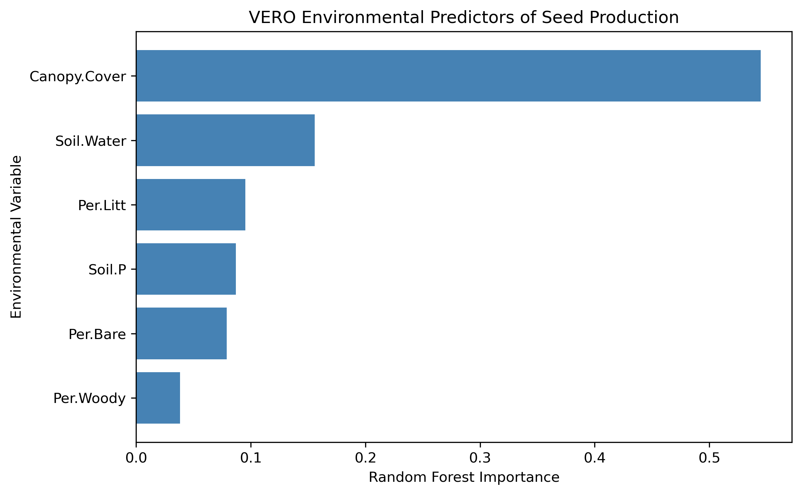

The importance values indicate which variables the Random Forest relied on most when making predictions, but they do not demonstrate that those variables successfully predicted VERO seed production on previously unseen plots.

#### Outliers

| Plot ID | Entries | Total Seeds | Mean | Median |
| --- | --- | --- | --- | ---: |
| 2 | 475 | 6548 | 13.79 | 14 |
| 15 | 304 | 5342 | 17.57 | 23 |

Together, these plots contained **779** of the **3,027 VERO observations (25.74%)**. Because approximately one-quarter of all VERO observations originated from only two plots, a sensitivity analysis was performed to determine whether their high representation was disproportionately influencing model performance and feature importance.

Plots 2 and 15 were temporarily excluded, leaving 2,248 observations across 44 plots, and the VERO Random Forest was rerun using the same predictors and modeling approach.

#### Sensitivity Analysis

| Metric | Value |
| --- | ---: |
| Mean R² | -0.344 |
| Mean MAE | 20.74 seeds |
| Mean RMSE | 25.67 seeds |

Removing Plots 2 and 15 produced only a small improvement in R², from −0.366 to −0.344. At the same time, prediction errors increased, with MAE increasing from 18.13 to 20.74 seeds and RMSE increasing from 22.92 to 25.67 seeds.

Feature importance also remained broadly similar after the two plots were removed. Canopy cover remained the most important predictor, decreasing slightly from 0.545 to 0.514. Litter cover increased in importance from 0.095 to 0.166, while soil water remained similar at 0.159.

| Variable | Importance |
| --- | ---: |
| Canopy.Cover | 0.514 |
| Soil.Litt | 0.166 |
| Soil.Water | 0.159 |
| Soil.P | 0.079 |
| Per.Bare | 0.054 |
| Per.Woody | 0.029 |

#### **6.5.2 Model 3b - ARCA**
ARCA was well represented across the dataset, but observations were unevenly distributed among plots. Several plots contained relatively large numbers of ARCA observations, while many others contained only a small number.

Total ARCA seed production also varied substantially among plots. Some plots produced several thousand seeds, while others contributed comparatively little. As with VERO, differences in total seed production among plots likely reflect both the number of ARCA observations within each plot and variation in seed production among individual plants.

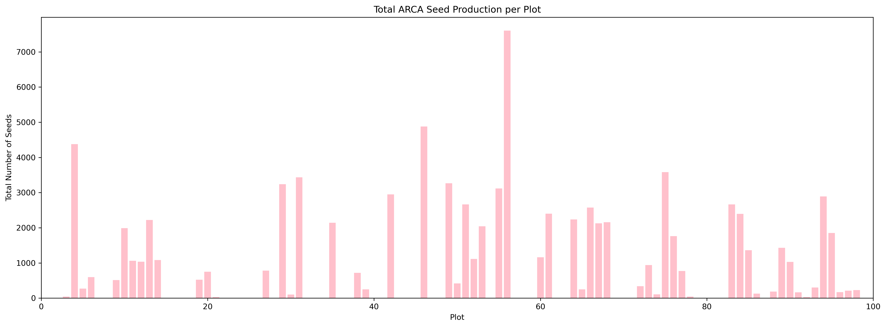

#### Model Performance

| Metric | Value |
| --- | ---: |
| Mean R² | -0.732 |
| Mean MAE | 69.87 seeds |
| Mean RMSE | 99.35 seeds |

The ARCA-specific Random Forest showed poor predictive performance. The mean cross-validated R² was **−0.732**, indicating that predictions on held-out plots performed substantially worse than a simple baseline based on the mean seed count.

The mean absolute error was **69.87 seeds**, while the root mean squared error was **99.34 seeds**. The larger RMSE relative to MAE suggests that some prediction errors were particularly large.

#### Feature importance

| Variable | Importance |
| --- | ---: |
| Soil.Water | 0.331 |
| Soil.P | 0.271 |
| Canopy.Cover | 0.178 |
| Per.Bare | 0.153 |
| Per.Litt | 0.037 |
| Per.Woody | 0.030 |

Soil water had the greatest feature importance (0.331), followed by soil phosphorus (0.271). Canopy cover (0.178) and percent bare ground (0.153) also contributed meaningfully to the model, while percent litter and percent woody cover had relatively low importance.

Although soil water and soil phosphorus were the most influential predictors within the fitted Random Forest, these importance values should be interpreted cautiously because overall predictive performance was poor. The negative cross-validated R² indicates that the model did not generalize well to unseen plots.

#### Outliers

| Plot ID | Entries | Total Seeds | Mean | Median |
| --- | --- | --- | --- | ---: |
| 56 | 27 | 7605 | 281.67 | 204 |

Plot 56 contained only 27 observations, but these observations produced a total of 7,605 seeds, with a mean of 281.67 seeds per observation and a median of 204 seeds. Unlike the VERO outlier investigation, the unusual characteristic of Plot 56 was therefore primarily its high seed production rather than unusually high representation.

A sensitivity analysis was performed by temporarily excluding Plot 56 and rerunning the ARCA Random Forest using the same environmental predictors and modeling approach. This left 2,488 observations across 60 plots.

#### Sensitivity Analysis

| Metric | Value |
| --- | ---: |
| Mean R² | -1.229 |
| Mean MAE | 74.21 seeds |
| Mean RMSE | 99.27 seeds |

Removing Plot 56 did not improve ARCA model performance. Mean R² decreased substantially from −0.732 to −1.229, indicating poorer predictive performance on held-out plots. MAE also increased from 69.87 to 74.21 seeds, while RMSE remained nearly unchanged at 99.34 and 99.27 seeds, respectively.

Feature importance changed more noticeably after Plot 56 was removed. Soil phosphorus increased from 0.271 to 0.426 and became the most important predictor, while soil water decreased from 0.331 to 0.164.

| Variable | Importance |
| --- | ---: |
| Soil.P | 0.426 |
| Canopy.Cover | 0.173 |
| Soil.Water | 0.164 |
| Per.Bare | 0.126 |
| Per.Litt | 0.063 |
| Per.Woody | 0.049 |

The sensitivity analysis suggests that Plot 56 influences the relative importance assigned to soil water and soil phosphorus, but its inclusion was not responsible for the poor overall predictive performance of the ARCA model. Excluding the plot substantially worsened R² and increased MAE without meaningfully reducing RMSE. Therefore, the results do not provide a model-performance-based reason to exclude Plot 56 from the final ARCA analysis.

#### **6.5.3 Model 3c - PEAI**
PEAI observations were distributed across many plots, although sampling was highly uneven. Plot 24 contained substantially more observations than any other plot.

Seed production showed even greater variation across plots. Several plots produced more than 20,000 total seeds, while many produced fewer than 5,000. Notably, the plots with the greatest seed production were not necessarily those with the largest numbers of observations, suggesting substantial differences in seed production per observation.

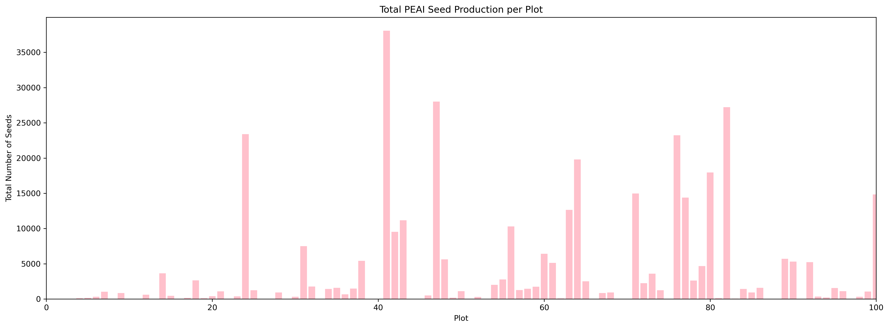

Model 3c produced a mean cross-validated R² of **−0.591**, indicating poor predictive performance on held-out plots. Prediction errors were also relatively large, with a mean MAE of **154.67 seeds** and RMSE of **265.22 seeds**.

The substantial difference between MAE and RMSE is consistent with the large variation in PEAI seed production, as particularly large prediction errors have a greater effect on RMSE.

#### Model Performance

| Metric | Value |
| --- | ---: |
| Mean R² | -0.591 |
| Mean MAE | 154.67 seeds |
| Mean RMSE | 265.22 seeds |

Unlike VERO, no single environmental variable overwhelmingly dominated the PEAI model. Soil phosphorus had the highest importance (0.298), followed by soil water (0.253) and percent litter (0.223). Together, these three variables accounted for most of the model's feature importance.

#### Feature importance

| Variable | Importance |
| --- | ---: |
| Soil.P | 0.298 |
| Soil.Water | 0.253 |
| Per.Litt | 0.223 |
| Per.Bare | 0.146 |
| Canopy.Cover | 0.049 |
| Per.Woody | 0.031 |

 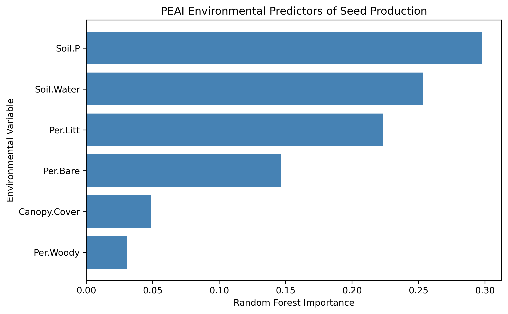

Despite these differences in relative importance, the negative R² indicates that the environmental predictors did not generalize well enough to reliably predict PEAI seed production across unseen plots. The high variability in PEAI seed counts may have contributed to the model's difficulty in producing accurate predictions.

#### Outliers

A large proportion of the PEAI dataset was associated with plots identified as unusual during exploratory analysis. The flagged plots contained **1,144 of the 2,485 PEAI observations (46.04%).**

| Plot ID | Entries | Total Seeds | Mean | Median |
| --- | --- | --- | --- | ---: |
| 24 | 652 | 23387 | 35.87 | 32 |
| 41 | 96 | 38071 | 396.57 | 303 |
| 47 | 121 | 28023 | 231.60 | 124 |
| 64 | 16 | 19802 | 1237.62 | 718 |
| 71 | 34 | 14980 | 440.59 | 254 |
| 76 | 32 | 23233 | 726.03 | 518 |
| 77 | 65 | 14388 | 221.35 | 156 |
| 80 | 40 | 17966 | 449.15 | 328 |
| 82 | 38 | 27224 | 716.42 | 397 |
| 100 | 50 | 14852 | 297.04 | 241 |

The unusual PEAI distribution may be influenced by the original sampling design. PEAI was not a primary species of focus during data collection, and its representation therefore differed considerably among plots. Plot 24, for example, was unusual primarily because of its large number of PEAI observations, whereas several other flagged plots contained fewer observations but much greater mean seed production.

Because nearly half of all PEAI observations were associated with these plots, they were not assumed to represent erroneous data. Instead, a sensitivity analysis was performed to evaluate how strongly these plots influenced model performance.

The 10 flagged plots were temporarily excluded and the PEAI Random Forest was rerun using the same environmental predictors and modeling approach. This left 1,341 observations across 64 plots.

#### Sensitivity Analysis

| Metric | Value |
| --- | ---: |
| Mean R² | -0.306 |
| Mean MAE | 106.45 seeds |
| Mean RMSE | 150.93 seeds |

Removing the flagged plots substantially improved all three performance metrics. Mean R² increased from −0.591 to −0.306, while MAE decreased from 154.67 to 106.45 seeds and RMSE decreased from 265.22 to 150.93 seeds. The particularly large reduction in RMSE suggests that the flagged plots contributed to some of the model's largest prediction errors.

Despite these improvements, R² remained negative, indicating that the environmental predictors still did not provide reliable predictions for held-out plots after the flagged observations were removed.

Feature importance also changed following exclusion of the flagged plots. Soil water increased substantially in importance and became the dominant predictor, while percent litter decreased considerably.

| Variable | Importance |
| --- | ---: |
| Soil.Water | 0.441 |
| Soil.P | 0.235 |
| Canopy.Cover | 0.149 |
| Per.Bare | 0.073 |
| Per.Litt | 0.056 |
| Per.Woody | 0.046 |

The sensitivity analysis indicates that the unusual PEAI distribution had a substantial influence on both model performance and feature importance. However, excluding the flagged plots removed **46.04% of all PEAI observations**, substantially altering the dataset being modeled. Therefore, the improved performance alone does not justify treating these observations as invalid or removing them from the primary analysis. Instead, the comparison demonstrates that PEAI model results are particularly sensitive to the uneven distribution and high seed production observed in a subset of plots.

#### **6.5.4 Model 3d - POCA**
POCA observations were spread across multiple portions of the study plots, with higher concentrations occurring in several plots in the 80–100 range. Compared with PEAI, no single plot overwhelmingly dominated the number of observations.

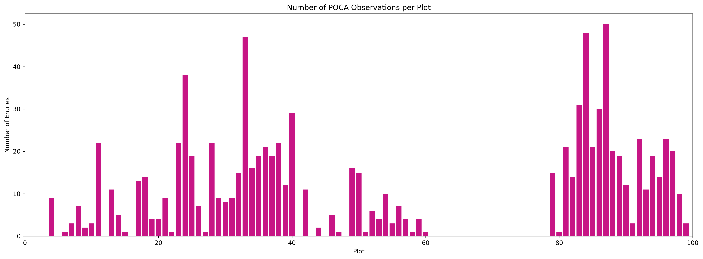

Total POCA seed production varied considerably across these plots. Most plots produced fewer than 5,000 total seeds, while a small number had substantially greater production. In particular, one plot exceeded 10,000 total seeds despite not having the greatest number of POCA observations.

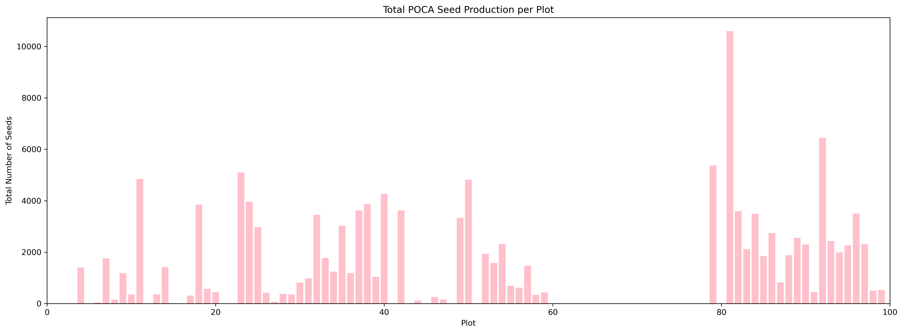

#### Model Performance

| Metric | Value |
| --- | ---: |
| Mean R² | -0.321 |
| Mean MAE | 174.48 seeds |
| Mean RMSE | 241.36 seeds |

Model 3d had a mean cross-validated R² of **−0.321**. Although this was the least negative R² among the four species-specific models, performance remained below the baseline represented by an R² of zero.

The model produced an MAE of **174.48 seeds** and an RMSE of **241.36 seeds**. These relatively large errors reflect the difficulty of predicting the substantial variation in individual POCA seed counts using the environmental variables available.

#### Feature importance

| Variable | Importance |
| --- | ---: |
| Soil.P | 0.303 |
| Canopy.Cover | 0.237 |
| Per.Litt | 0.152 |
| Soil.Water | 0.143 |
| Per.Bare | 0.092 |
| Per.Woody | 0.074 |

Soil phosphorus was the highest-ranked predictor for POCA (0.303), followed by canopy cover (0.237). Percent litter and soil water had intermediate importance, while percent bare ground and percent woody cover contributed less to the fitted model.

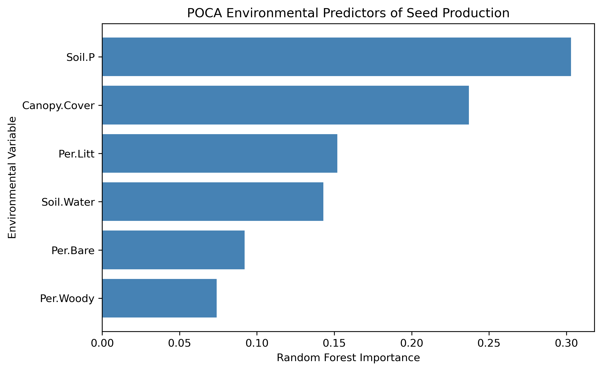

#### Outliers

Exploration of POCA seed production identified Plot 81 as having unusually high seed production relative to the remaining plots.

| Plot ID | Entries | Total Seeds | Mean | Median |
| --- | --- | --- | --- | ---: |
| 81 | 21 | 10591 | 504.33 | 447 |

Plot 81 contained only 21 observations, but these observations produced a total of 10,591 seeds, with a mean of 504.33 seeds per observation and a median of 447 seeds. The unusual characteristic of Plot 81 was therefore its high seed production rather than unusually high representation within the dataset.

A sensitivity analysis was performed by temporarily excluding Plot 81 and rerunning the POCA Random Forest using the same environmental predictors and modeling approach. This left 922 observations across 70 plots.

#### Sensitivity Analysis

| Metric | Value |
| --- | ---: |
| Mean R² | -0.082 |
| Mean MAE | 138.54 seeds |
| Mean RMSE | 204.17 seeds |

Removing Plot 81 improved all three model performance metrics. Mean R² increased from −0.321 to −0.082, bringing model performance substantially closer to the baseline represented by an R² of zero. MAE decreased from 174.48 to 138.54 seeds, while RMSE decreased from 241.36 to 204.17 seeds.

Unlike the PEAI sensitivity analysis, this improvement resulted from removing only 21 of 943 observations (2.23%). This suggests that the unusually high seed production associated with Plot 81 had a disproportionate influence on the model's ability to generalize across plots.

Feature importance remained relatively stable following the removal of Plot 81.

| Variable | Importance |
| --- | ---: |
| Soil.P | 0.257 |
| Canopy.Cover | 0.251 |
| Soil.Water | 0.175 |
| Per.Litt | 0.142 |
| Per.Bare | 0.092 |
| Per.Woody | 0.084 |

Soil phosphorus and canopy cover remained the two most important predictors, although canopy cover became nearly equal to soil phosphorus after Plot 81 was removed. The remaining variables showed relatively small changes in importance.

Overall, the sensitivity analysis indicates that Plot 81 had a substantial influence on POCA model performance despite representing only 2.23% of POCA observations. However, model performance remained slightly below the R² = 0 baseline after its removal. Unless there is independent evidence that Plot 81 represents a sampling or data-quality issue, its influence alone does not establish that the observations should be removed from the primary analysis.

#### **6.5.5 Comparison Across Species**
#### Model Performance Comparison

| Species| Observations | Plots | R² | MAE | RMSE |
| --- |--- |--- |--- |--- | ---: |
| VERO | 3027 | 46 | -0.366 | 18.13 | 22.92 |
| ARCA | 2515 | 61 | -0.732 | 69.87 | 99.35 |
| PEAI | 2485 | 74 | -0.591 | 154.67 | 265.22 |
| POCA | 943 | 71 | -0.321 | 174.48 | 241.36 |

POCA had the R² closest to zero (−0.321), followed by VERO (−0.366), PEAI (−0.591), and ARCA (−0.732). However, all four R² values remained negative, indicating that none of the species-specific Random Forest models reliably predicted individual seed production in previously unseen plots using the six environmental predictors.

Prediction error also differed substantially among species. VERO had considerably lower MAE and RMSE values than the other three species, while PEAI and POCA had much larger prediction errors. However, MAE and RMSE should not be directly interpreted as measures of which species had the strongest model because seed production occurred on different scales among species. Species with larger and more variable seed counts can naturally produce larger absolute errors.

The number of observations also did not correspond directly with model performance. VERO had the largest number of observations and relatively low prediction errors, while POCA had the fewest observations but an R² closest to zero. ARCA and PEAI both contained more than 2,000 observations but continued to show poor predictive performance. This suggests that increasing the number of observations alone was not sufficient to produce reliable predictions across previously unseen plots.

Overall, separating the dataset by species did not resolve the poor predictive performance observed in the broader seed-production models. Although the strength and relative importance of environmental predictors differed among species, the consistently negative R² values suggest that the six plot-level environmental variables alone did not capture enough of the variation in individual seed production to generalize reliably across plots.

### **6.6 Discussion / Next Steps**
The next stage of the project will focus specifically on VERO rather than continuing to model multiple species. VERO was a primary species of interest in the original dissertation and was well represented within the available dataset, with 3,027 observations across 46 plots. Focusing on VERO also reduces concerns associated with differences in how other species were represented during data collection. For example, the PEAI analysis showed that uneven representation among plots could have a substantial influence on model performance.

The next step will focus on **evaluating and expanding the predictors used to model VERO seed production**. Models 0–3 relied primarily on six environmental variables: litter cover, bare ground, woody vegetation, soil phosphorus, soil water, and canopy cover. Although these variables describe important environmental conditions, they do not directly account for the surrounding plant community or potential interactions among species.

To address this limitation, additional ecological predictors will be developed using the available plot-level and species data. These will include measures of species diversity, functional composition, taxonomic composition, and potential competition. For example, the number of individuals within a plot may provide information about plant density and competitive pressure, while species diversity and functional group proportions may help describe differences in community structure.

**The next stage will also reconsider the cross-validation strategy used in previous models**. Models 0–3 used GroupKFold cross-validation to evaluate whether models could predict reproductive output in entirely unseen plots. However, the consistently negative R² values suggest that the available predictors provided limited generalization across plots. Model 4 will therefore compare GroupKFold with standard KFold, with the subsequent analysis focusing on standard KFold to investigate predictive relationships within the sampled plot population.

This change also shifts the overarching research question. Rather than primarily asking whether environmental conditions can predict reproductive output in **unseen plots**, the remaining models will investigate **how accurately individual VERO seed production can be predicted using environmental and ecological characteristics within the sampled plots**. Because standard KFold allows observations from the same plot to appear in both training and testing subsets, its results cannot be interpreted as evidence of predictive performance in entirely new plots.

The expanded predictor dataset will then be explored to identify relationships with VERO seed production. This will involve examining the distribution of seed counts, identifying extreme observations, investigating variation among plots, and evaluating correlations between seed production and the environmental and ecological predictors. Particular attention will be given to understanding whether unusually high seed counts represent meaningful ecological variation rather than observations that should automatically be excluded.

Following this exploratory analysis, different groups of predictors will be evaluated to determine whether incorporating community-level information improves predictive performance compared with the original environmental variables alone. The effects of outlier treatment and response-variable transformations will also be investigated to better understand how the distribution of seed production influences model performance.

The overall goal of this next stage is to **identify which ecological characteristics provide the most useful information for predicting individual VERO seed production within the sampled plot population**. Establishing a more informative set of predictors will provide a foundation for subsequent comparisons of machine-learning algorithms and further refinement of the VERO models.

---
## **7. Model 4 - Ecological Predictor Exploration and Evaluation**

### **7.1 Research Question**
How do extreme individual VERO seed counts and additional plot-level ecological predictors affect Random Forest predictions of seed production?

Model 4 focuses specifically on VERO, which was selected for continued analysis because it was a primary species of interest in the original dissertation and was well represented in the seed dataset.

Model 3 used a Random Forest with GroupKFold cross-validation, where observations were grouped by plot. Model 4 builds on this approach by investigating the influence of extreme seed counts, evaluating additional ecological predictors, and comparing model performance using both GroupKFold and standard KFold cross-validation.

Model 4 is framed to investigate four questions:

1. How are extreme VERO seed counts distributed across plots, and are they associated with particular environmental conditions?
2. Do additional ecological predictors, including species richness, individual abundance, elevation, and beta diversity, improve predictions of VERO seed production?
3. How do outlier filtering and log transformation of seed counts affect Random Forest predictive performance?
4. How does model performance differ between GroupKFold and standard KFold cross-validation?

### **7.2 Data**

Model 4 focuses exclusively on VERO, using 3,027 individual observations across 46 plots.

The analysis combines three datasets:
- `seeds.csv`: Individual seed production and species identification.
- `plots.csv`: Plot-level environmental conditions.
- `species.csv`: Species characteristics, including life form, family, and origin.

These datasets are used to create an expanded dataset containing both the original environmental variables and additional ecological predictors.

### **7.3 Predictors**

#### **7.3.1 Original Environmental Predictors**

The six environmental predictors used in previous models are retained:

- `Per.Litt` — percent litter cover
- `Per.Bare` — percent bare ground
- `Per.Woody` — percent woody cover
- `Soil.P` — soil phosphorus
- `Soil.Water` — soil water
- `Canopy.Cover` — canopy cover

#### **7.3.2 Additional Ecological Predictors**

New predictors are created to describe the surrounding plant community and potential competition.

- `Species Diversity` — Species richness, Shannon diversity, Simpson diversity, and evenness
- `Functional Composition` — Proportions and diversity of plant life forms
- `Family Composition` — Proportions of different plant families
- `Species Composition` — Relative representation of individual species
- `Competition` — Measures of plant abundance, density, and potential competition
- `Community Composition` — Measures describing differences in species composition among plots

These predictors are intended to capture ecological characteristics not represented by the original environmental variables.

### **7.4 Model Approach**

Model 4 is divided into four stages:

**Model 4a — Predictor Creation**
The original datasets are combined to calculate additional plot-level ecological predictors. These include measures of diversity, functional composition, taxonomic composition, and competition.

**Model 4b — Exploratory Analysis**
VERO seed production is examined to understand its distribution, identify extreme observations, and investigate relationships with the ecological predictors. Correlations are evaluated at the plot level to avoid treating repeated plot measurements as independent observations.

**Model 4c — Predictor Group Comparison**
Random Forest models are used to compare seven predictor groups:

1. Baseline environmental predictors
2. Functional composition
3. Family composition
4. Species composition
5. Diversity
6. Competition
7. Combined ecological predictors

Each group is evaluated using three approaches to the response variable: original seed counts, IQR-based outlier filtering, and log-transformed seed counts.

Both KFold and GroupKFold cross-validation are tested to examine how the validation method affects model performance.

**Model 4d — Results and Diagnostics**
The results are examined in greater detail to identify the most useful predictors and investigate prediction errors. This includes examining high-seed observations, differences among plots, and permutation feature importance.

### **7.5 Results**

#### **7.5.1 Seed Distribution and Outliers**
The distribution of individual VERO seed counts was examined using the interquartile range (IQR) method. Observations falling below Q1 − 1.5 × IQR or above Q3 + 1.5 × IQR were identified as potential outliers.

VERO seed production was right-skewed, with most individuals producing relatively few seeds and a smaller number producing substantially higher counts.

| Statistic | Value |
| --- | ---: |
| Observations | 3,027 |
| Mean seed count | 18.47 |
| Median seed count | 14 |
| Standard deviation | 20.12 |
| Maximum seed count | 184 |
| Zero-seed observations | 93 |
| IQR outliers | 210 (6.94%) |

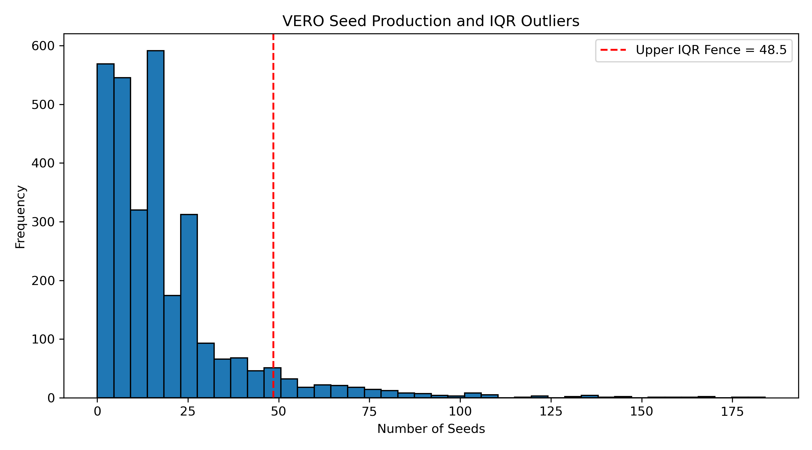

Using the IQR method, seed counts above 48.5 were identified as potential outliers. These observations were retained during exploratory analysis because unusually high seed production may represent meaningful ecological variation.

#### **7.5.2  Relationships Between Predictors and Seed Production**
Plot-level correlation analysis identified several ecological predictors associated with mean VERO seed production.

| Predictor | Spearman correlation |
| --- | ---: |
| Family_Prop_Poaceae | +0.605 |
| SpeciesProp_PEAI | +0.604 |
| LifeForm_Prop_annual.forb | -0.599 |
| LifeForm_Prop_annual.graminoid | +0.583 |
| LifeForm_Shannon | +0.576 |

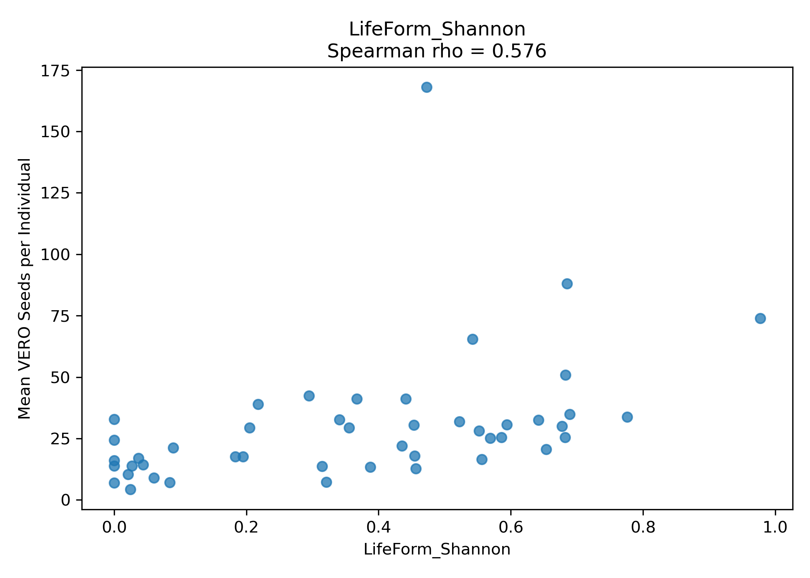

These results suggest that plant community composition, particularly the representation of different functional groups, may be associated with VERO seed production.

However, correlations do not necessarily indicate that these predictors will improve model performance.

#### **7.5.3 Predictor Group Comparison**
Model 4c evaluated 42 configurations across seven predictor groups, three response-variable treatments, and two cross-validation methods.

The strongest GroupKFold configuration used functional predictors with log-transformed seed counts.

| Configuration | R² | MAE | RMSE |
| --- | --- | --- | ---: |
| GroupKFold – Baseline, Original | -0.389 | 18.29 | 23.06 |
| GroupKFold – Functional, Log1p | 0.040 | 12.34 | 19.48 | 
| KFold – Combined, Original | 0.199 | 10.83 | 17.91 |

 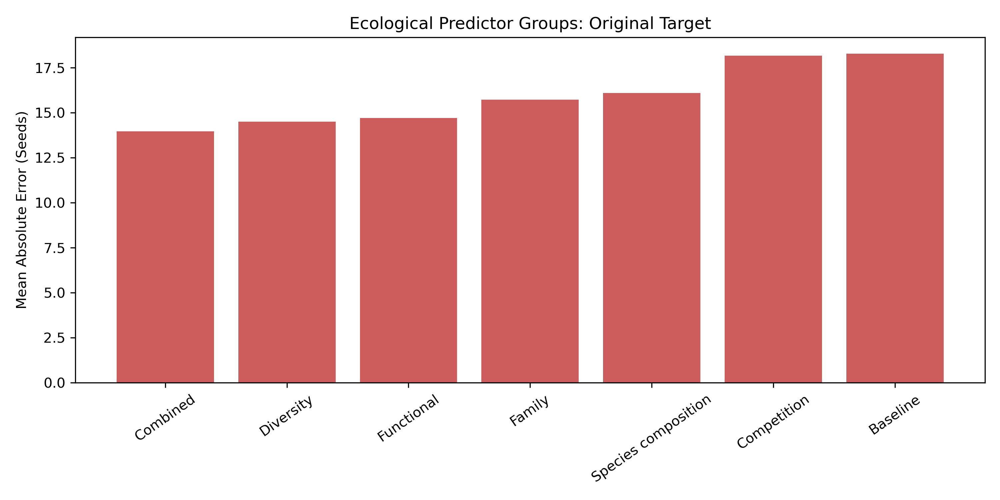

The results indicate that functional predictors and response-variable treatment can influence predictive performance. Standard KFold generally produced stronger results than GroupKFold, although the methods evaluate different prediction settings.

#### **7.5.4 Prediction Errors and High-Seed Observations**

Further analysis of the selected GroupKFold configuration showed that the model struggled to predict individuals with unusually high seed production.

| Observation Group | Observed Mean | Predicted Mean | MAE |
| --- | --- | --- | ---: |
| High-seed observations (210) | 75.93 | 19.04 | 56.89 |
| Remaining observations (2,817) | 14.19 | 15.20 | 9.02 |

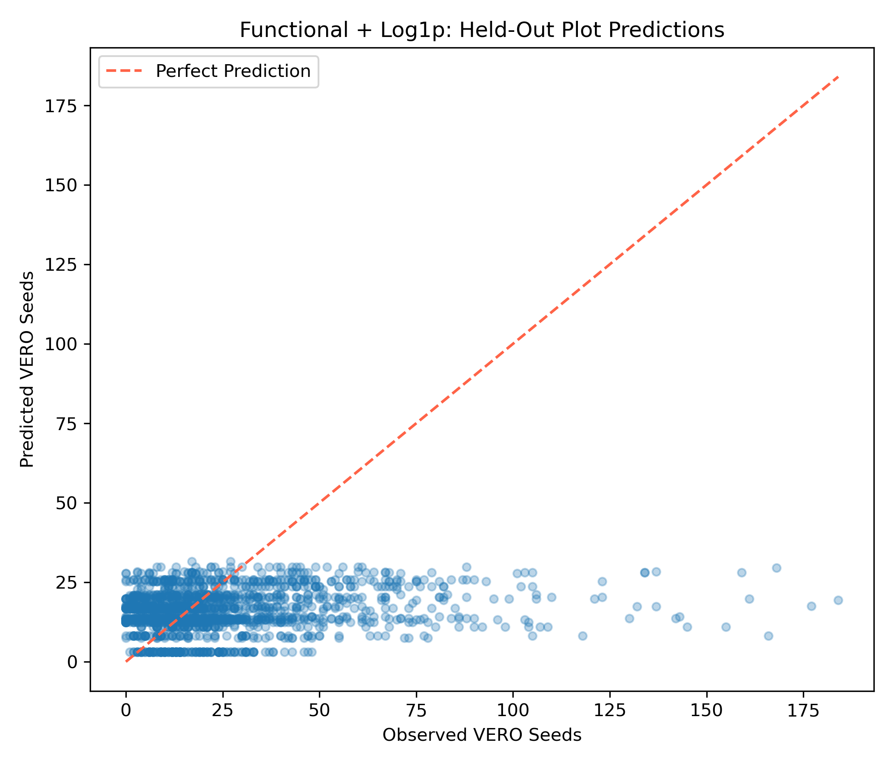

The model substantially underestimated high-seed observations, suggesting that the available ecological predictors do not fully explain extreme seed production.

#### **7.5.5 Predictor Importance**

Permutation importance was used to evaluate which predictors contributed most to the selected model's predictive performance.

The highest-ranked predictors were:

| Predictor | Permutation Importance |
| --- | ---: |
| LifeForm_Shannon | +0.0167 |
| LifeForm_Prop_annual.graminoid | +0.0156 |
| LifeForm_Prop_annual.forb | +0.0129 |
| Soil.Water | +0.0081 |
| Per.Bare | +0.0048 |

 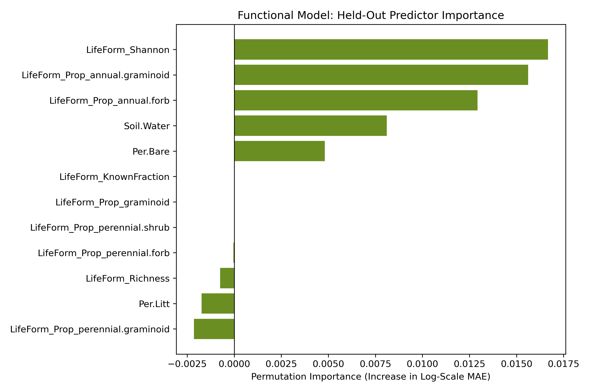

Functional diversity and composition were the most influential predictors in this analysis.

### **7.6 Interpretation**
Model 4 suggests that plant community characteristics provide useful information for predicting VERO seed production. In particular, functional diversity and the proportions of annual forbs and annual graminoids were among the most influential predictors.

However, overall predictive performance remained limited, especially when models were evaluated on previously unseen plots. High-seed observations were also consistently underestimated, indicating that substantial variation in individual seed production remains unexplained.

The results suggest that adding ecological predictors can improve model performance, but the usefulness of these predictors depends on the modeling approach and evaluation method.

### **7.7 Discussion / Next Steps**
Based on the results of Model 4, the next stage will retain the six original environmental predictors and three additional functional predictors:

- LifeForm_Shannon
- LifeForm_Prop_annual.graminoid
- LifeForm_Prop_annual.forb

These predictors were selected because they showed the strongest positive permutation importance in Model 4d.

**Model 5 will focus on comparing different machine-learning algorithms** using this fixed set of nine predictors. This will help determine whether alternative modeling approaches can improve VERO seed production predictions beyond the Random Forest models evaluated in Model 4.

All valid observations, including high-seed counts, will be retained because extreme seed production may represent meaningful ecological variation.

---
## **8. Model 5 - Alternative Machine Learning Approaches**

### **8.1 Research Question**

How does the predictive performance of different machine learning algorithms and count-based regression approaches compare when predicting individual VERO seed production using the environmental and ecological predictors selected from Model 4?

Model 4 evaluated additional ecological predictors and compared cross-validation strategies, ultimately establishing a predictor set for further evaluation. Building on these findings, Model 5 compares alternative regression approaches using the same nine predictors and standard KFold cross-validation.

Model 5 addresses two primary questions:
1. Do alternative machine learning algorithms improve predictions of individual VERO seed production compared with Random Forest?
2. Do regression approaches designed for count outcomes improve predictive performance compared with conventional regression methods?

Unlike the earlier models that emphasized generalization to entirely unseen plots, Model 5 focuses on predicting held-out individual observations from the sampled plot population. This allows algorithm performance to be compared under a consistent evaluation framework, while recognizing that the results do not establish predictive accuracy in previously unseen plots.

### **8.2 Data**
Model 5 uses the expanded VERO dataset created during Model 4, combining individual seed production with environmental and ecological predictors.

| Species | Observations | Number of Plots |
| --- | ---: | ---: |
| VERO | 3,027 | 46 |

The response variable remains `Num.Seed`, representing the number of seeds recorded for an individual observation.

All observations were retained, including extreme seed counts identified during the exploratory analysis in Model 4. No observations were excluded solely because of unusually high seed production.

Using the same VERO observations and predictor variables across all seven algorithms allowed differences in predictive performance to be evaluated under consistent data conditions.

### **8.3 Predictors**
Model 5 uses nine predictors, consisting of the six original environmental variables and three functional predictors selected from Model 4.

**Environmental Predictors**
- `Per.Litt` — percent litter cover
- `Per.Bare` — percent bare ground
- `Per.Woody` — percent woody cover
- `Soil.P` — soil phosphorus
- `Soil.Water` — soil water
- `Canopy.Cover` — canopy cover

**Functional Predictors**
- `LifeForm_Shannon` — Shannon diversity of plant functional groups within a plot
- `LifeForm_Prop_annual.graminoid` — Proportion of individuals classified as annual graminoids
- `LifeForm_Prop_annual.forb` — Proportion of individuals classified as annual forbs

The three functional predictors were retained following the evaluations conducted in Model 4, where they demonstrated positive permutation importance in predicting VERO seed production. Their inclusion allows Model 5 to incorporate information about plant functional diversity and composition alongside the original environmental conditions.

Species identity was not included as a separate predictor because the analysis was restricted to VERO.

The same nine predictors were used across all seven algorithms to ensure that differences in predictive performance reflected the modeling approaches rather than differences in predictor selection.

### **8.4 Model Approach**
Model 5 compared seven regression approaches:

- **Random Forest:** An ensemble of decision trees using a squared-error splitting criterion to predict continuous seed counts.
- **Random Forest (Poisson):** The same general Random Forest approach, but using a Poisson deviance splitting criterion designed for nonnegative count responses. This is not a full probabilistic Poisson regression model.
- **Negative Binomial Regression:** A count regression approach that allows the variance of seed counts to exceed their mean. This is a separate regression method, not a Negative Binomial Random Forest.
- **Linear Regression:** A linear baseline that models seed counts as a function of the selected environmental and functional ecological predictors.
- **Gradient Boosting:** A sequential ensemble of decision trees in which successive trees improve on earlier predictions.
- **Extra Trees:** A randomized tree ensemble that introduces additional randomness when selecting tree splits.
- **K-Nearest Neighbors:** A distance-based method that predicts using observations with similar predictor values.

All seven approaches were evaluated using **5-fold standard KFold cross-validation**, with shuffled folds and a fixed random seed (random_state=42). Unlike GroupKFold, standard KFold does not group observations by plot. Consequently, observations from the same plot may occur in both training and testing datasets.

Because the predictors are measured at the plot level, this approach evaluates prediction among held-out individual observations rather than generalization to entirely unseen plots.

Predictors were standardized using StandardScaler for Linear Regression, Negative Binomial Regression, and K-Nearest Neighbors. Scaling was performed within each cross-validation training fold using scikit-learn pipelines to prevent information leakage. Tree-based ensemble methods were evaluated without feature scaling.

Model performance was evaluated using:

- **R²** — proportion of variation in seed production explained by the model
- **MAE** — mean absolute difference between observed and predicted seed counts
- **RMSE** — measure of prediction error that gives greater weight to larger errors

**Permutation feature importance** was calculated for each algorithm to evaluate the contribution of individual predictors to predictive performance. For each cross-validation fold, predictor values were randomly shuffled within the held-out testing subset, and the resulting decrease in R² was measured. This procedure was repeated 10 times per predictor, with importance values averaged across the five folds.

A larger positive importance value indicates that shuffling a predictor caused a greater reduction in predictive performance, suggesting that the model relied more heavily on that predictor. Values near zero indicate little measurable change in performance, while negative values indicate that shuffling the predictor improved performance under the evaluation used.

Using permutation importance allowed predictor contributions to be evaluated consistently across all seven regression approaches, including tree-based, linear, count-based, and distance-based models.

### **8.5 Results**

#### **8.5.1 Model 5A - Random Forest (Squared Error)**
Random Forest was evaluated using the expanded predictor set to establish a comparison with the alternative algorithms.

| Metric | Value |
| --- | ---: |
| Mean R² | 0.200 |
| Mean MAE | 10.83 seeds |
| Mean RMSE | 17.90 seeds |

Random Forest produced a mean R² of **0.200**, an MAE of **10.83 seeds**, and an RMSE of **17.90 seeds**.

Random Forest achieved a mean R² of **0.200**, indicating positive predictive performance relative to a mean-based baseline under standard KFold cross-validation. The model produced an MAE of **10.83 seeds** and an RMSE of **17.90 seeds**.

 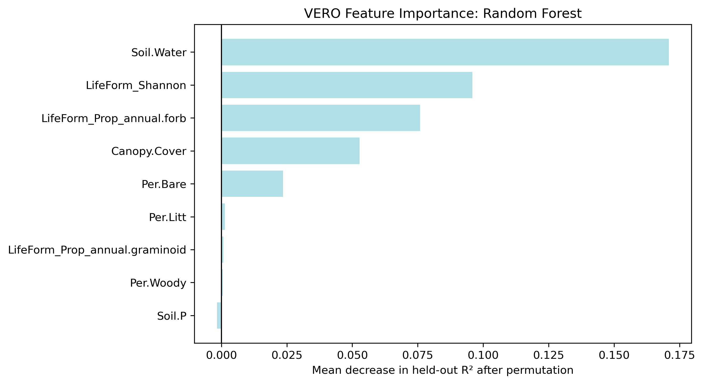

Permutation feature importance identified **Soil.Water(0.171)**, **LifeForm_Shannon(0.096)**, and **LifeForm_Prop_annual.forb(0.076)** as the most influential predictors. Soil water produced the largest decrease in predictive performance when shuffled, followed by functional diversity and annual forb composition. These results indicate that both environmental conditions and functional ecological characteristics contributed to the model's predictions.

#### **8.5.2 Model 5B - Random Forest Poisson**
Random Forest was also evaluated using the **Poisson splitting criterion**, which changes how decision-tree splits are selected for the nonnegative seed-count response. This was tested to determine whether a count-oriented splitting criterion would improve performance compared with the original squared-error Random Forest.

| Metric | Value |
| --- | ---: |
| Mean R² | 0.199 |
| Mean MAE | 10.83 seeds |
| Mean RMSE | 17.90 seeds |

Poisson Random Forest achieved a mean R² of **0.199**, an MAE of **10.83 seeds**, and an RMSE of **17.90 seeds**. These results were nearly identical to those of squared-error Random Forest, indicating that changing the splitting criterion did not meaningfully improve predictive performance.

 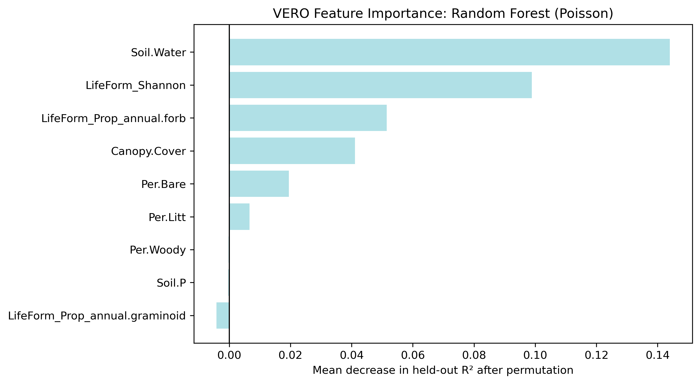

Permutation feature importance identified **Soil.Water(0.144)**, **LifeForm_Shannon(0.099)**, and **LifeForm_Prop_annual.forb(0.051)** as the strongest predictors. This ranking was consistent with squared-error Random Forest, suggesting that changing the splitting criterion had little effect on the relative importance of the leading predictors.

#### **8.5.3 Model 5C - Negative Binomial Regression**
Negative Binomial Regression was tested because seed production is a count response and may exhibit overdispersion, where variance exceeds the mean. Unlike the Random Forest models, Negative Binomial Regression uses a parametric count-regression framework.

| Metric | Value |
| --- | ---: |
| Mean R² | 0.111 |
| Mean MAE | 11.82 seeds |
| Mean RMSE | 18.85 seeds |

Negative Binomial Regression achieved a mean R² of **0.111**, an MAE of **11.82 seeds**, and an RMSE of **18.85 seeds**. Although the model demonstrated positive predictive performance relative to a mean-based baseline, its accuracy was lower than that of the Random Forest approaches.

 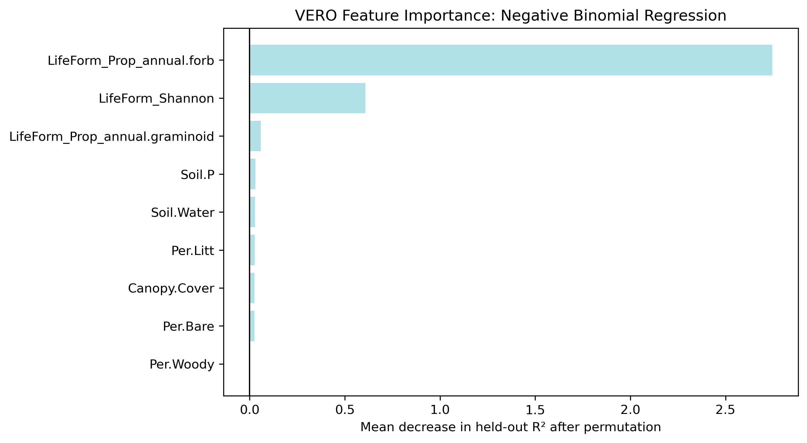

Permutation feature importance identified **LifeForm_Prop_annual.forb(2.745)** and **LifeForm_Shannon(0.608)** as the most influential predictors. The unusually large importance value for annual forb composition indicates that shuffling this variable substantially reduced predictive performance. However, the high variability across validation folds (SD = 1.914) suggests that the model's reliance on this predictor was not consistent across testing subsets.

These findings indicate that functional ecological composition played an important role in the model's predictions, although the magnitude and variability of the importance estimates warrant cautious interpretation.

#### **8.5.4 Model 5D - Linear Regression**
Linear Regression was evaluated as a simpler, non-tree-based alternative to the ensemble approaches, using the same nine environmental and functional ecological predictors.

| Metric | Value |
| --- | ---: |
| Mean R² | 0.135 |
| Mean MAE | 11.74 seeds |
| Mean RMSE | 18.62 seeds |

Linear Regression achieved a mean R² of **0.135**, an MAE of **11.74 seeds**, and an RMSE of **18.62 seeds**. Although the model demonstrated positive predictive performance relative to a mean-based baseline, it was less accurate than the Random Forest approaches. This suggests that the linear relationships represented by this model may not fully capture the predictive patterns available in the selected variables.

 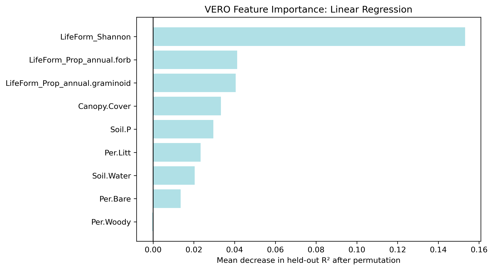

Permutation feature importance identified **LifeForm_Shannon(0.153)** as the strongest predictor, followed by **LifeForm_Prop_annual.forb(0.041)** and **LifeForm_Prop_annual.graminoid(0.041)**. Unlike the Random Forest approaches, Linear Regression relied more heavily on functional ecological predictors than on individual environmental variables, suggesting that functional diversity and composition provided particularly useful predictive information within this model.

#### **8.5.5 Model 5E - Gradient Boosting**
Gradient Boosting was evaluated as an alternative tree-based ensemble approach that sequentially builds decision trees to improve predictive performance.

| Metric | Value |
| --- | ---: |
| Mean R² | 0.203 |
| Mean MAE | 10.83 seeds |
| Mean RMSE | 17.87 seeds |

Gradient Boosting achieved a mean R² of **0.203**, an MAE of **10.83 seeds**, and an RMSE of **17.87 seeds**. It produced the highest mean R² and lowest mean RMSE among the seven approaches, although its performance was very similar to that of the other tree-based ensembles.

 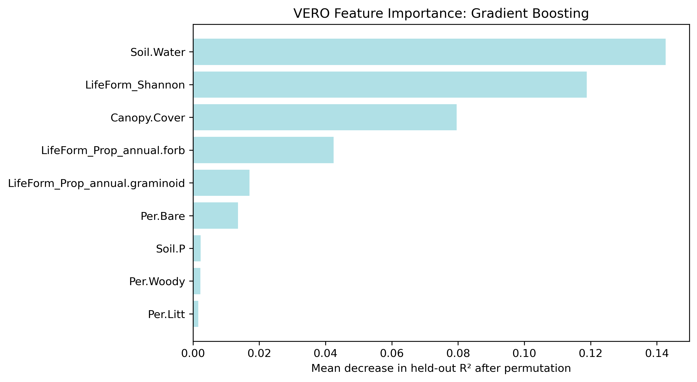

Permutation feature importance identified **Soil.Water(0.143)**, **LifeForm_Shannon(0.119)**, and **Canopy.Cover(0.080)** as the strongest predictors. Soil water produced the greatest decrease in predictive performance when shuffled, followed by functional diversity and canopy cover. These findings indicate that both environmental conditions and functional ecological characteristics contributed to the predictions of the highest-performing algorithm.

#### **8.5.6 Model 5F - Extra Trees**
Extra Trees was evaluated as an alternative tree-based ensemble approach that introduces additional randomness when selecting decision-tree splits.

| Metric | Value |
| --- | ---: |
| Mean R² | 0.198 |
| Mean MAE | 10.84 seeds |
| Mean RMSE | 17.92 seeds |

Extra Trees achieved a mean R² of **0.198**, an MAE of **10.84 seeds**, and an RMSE of **17.92 seeds**. Its predictive performance was nearly identical to that of Random Forest and Gradient Boosting, providing further evidence that the tested tree-based ensemble approaches achieved comparable accuracy.

 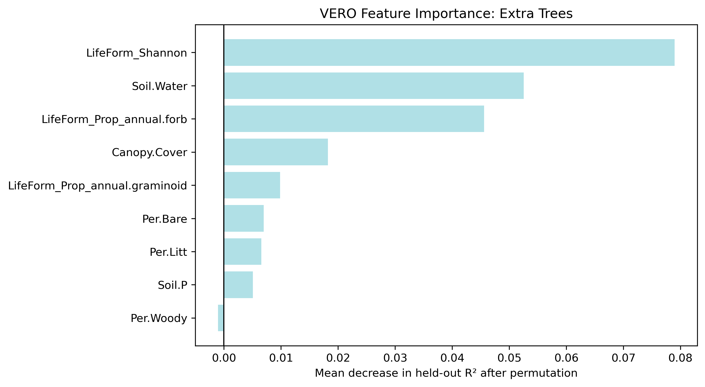

Permutation feature importance identified **LifeForm_Shannon(0.079)**, **Soil.Water(0.053)**, and **LifeForm_Prop_annual.forb(0.046)** as the most influential predictors. Unlike the other leading tree-based ensembles, Extra Trees identified functional diversity as its highest-ranked predictor, followed by soil water and annual forb composition. Nevertheless, the importance rankings were broadly consistent with the other ensemble approaches, indicating that environmental conditions and functional ecological characteristics contributed to predictive performance.

#### **8.5.7 Model 5G - K-Nearest Neighbors**
K-Nearest Neighbors (KNN) was tested as a non-tree-based machine learning approach.

| Metric | Value |
| --- | ---: |
| Mean R² | -0.072 |
| Mean MAE | 13.77 seeds |
| Mean RMSE | 20.60 seeds |

KNN achieved a mean R² of **−0.072**, indicating that its predictions performed worse than a mean-based baseline under standard KFold cross-validation. The model also produced the largest prediction errors among the seven approaches, with an MAE of **13.77 seeds** and an RMSE of **20.60 seeds.**

These results suggest that KNN was less effective at predicting VERO seed production under the predictor configuration and model settings evaluated.

 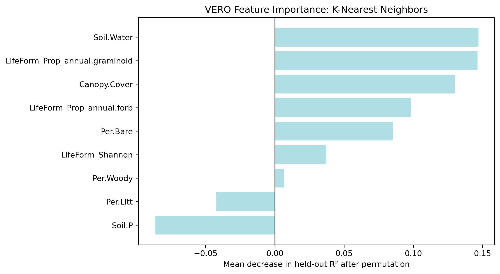

Permutation feature importance identified **Soil.Water(0.147)**, **LifeForm_Prop_annual.graminoid(0.146)**, and **Canopy.Cover(0.130)** as the strongest predictors. However, importance estimates varied substantially across cross-validation folds. Combined with the model's negative mean R², this variability suggests that the predictor rankings should be interpreted cautiously, as they do not necessarily indicate reliable predictive relationships.

#### **8.5.8 Model Comparison**

The predictive performance of all seven regression approaches was compared using mean R², MAE, and RMSE from 5-fold standard KFold cross-validation.

| Model | R² | MAE | RMSE |
| --- | ---: | ---: | ---: |
| Gradient Boosting | **0.203** | **10.83** | **17.87** |
| Random Forest (Squared Error) | 0.200 | 10.83 | 17.90 |
| Random Forest (Poisson) | 0.199 | 10.83 | 17.90 |
| Extra Trees | 0.198 | 10.84 | 17.92 |
| Linear Regression | 0.135 | 11.74 | 18.62 |
| Negative Binomial Regression | 0.111 | 11.82 | 18.85 |
| K-Nearest Neighbors | -0.072 | 13.77 | 20.60 |

Gradient Boosting achieved the highest mean R² (0.203) and lowest RMSE (17.87 seeds). However, differences among the four tree-based ensemble approaches were minimal, with mean R² values ranging from **0.198 to 0.203** and nearly identical prediction errors.

Linear Regression and Negative Binomial Regression achieved lower positive R² values of 0.135 and 0.111, respectively. K-Nearest Neighbors was the only approach with a negative mean R² (−0.072) and produced the largest prediction errors.

The count-oriented approaches did not demonstrate an improvement over conventional regression methods. Poisson Random Forest performed nearly identically to squared-error Random Forest, while Negative Binomial Regression achieved lower predictive accuracy than both Random Forest and Linear Regression.

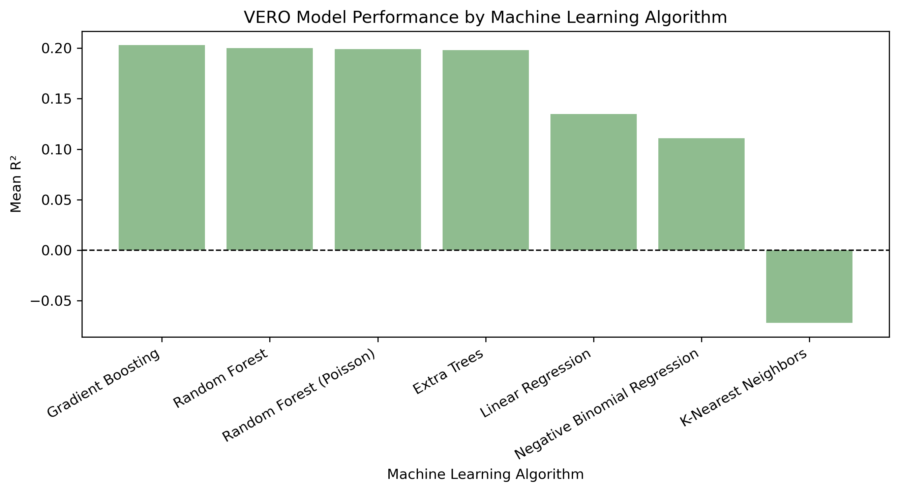  

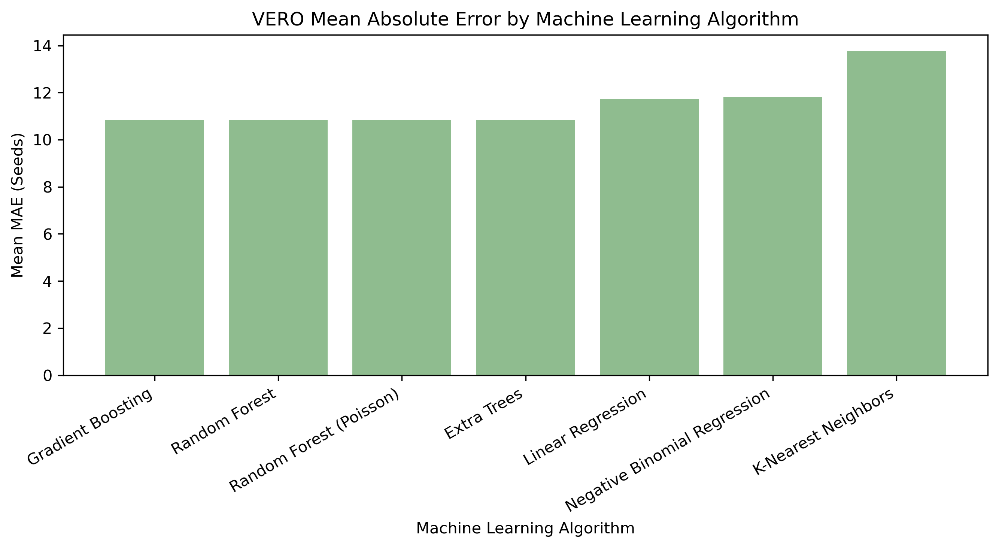  

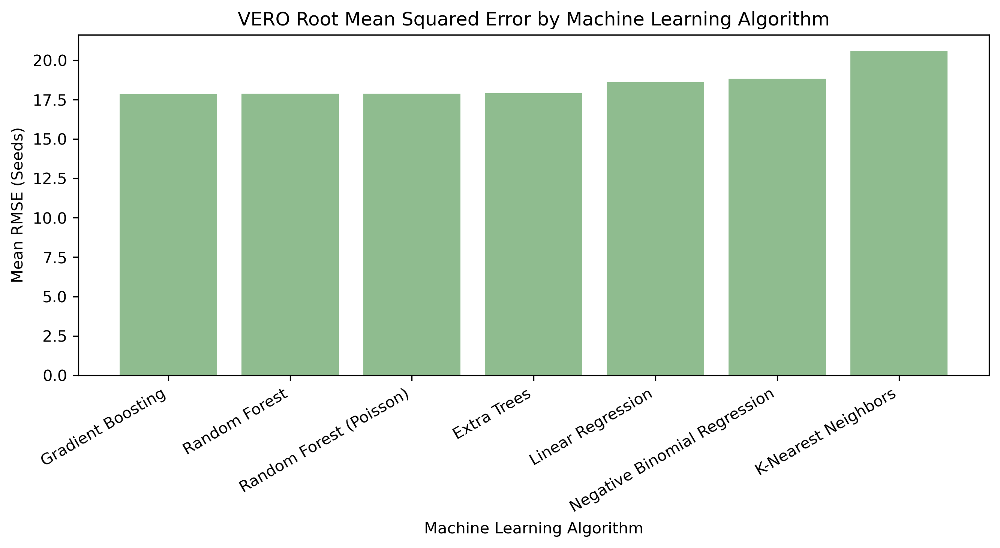  

Overall, **tree-based ensemble methods provided the strongest predictive performance** among the seven approaches evaluated.

Permutation feature importance also revealed several consistent patterns across algorithms. **Soil.Water** and **LifeForm_Shannon** were frequently among the highest-ranked predictors, particularly within the tree-based ensembles. **LifeForm_Prop_annual.forb** also demonstrated positive importance across multiple approaches, while **Per.Woody** generally exhibited little measurable importance.

Although the relative rankings varied between algorithms, the leading tree-based ensembles relied on overlapping environmental and functional ecological information.

### **8.6 Interpretation**
Model 5 demonstrated that tree-based ensemble methods achieved the strongest predictive performance among the seven approaches evaluated. However, their similar results suggest that changing the modeling algorithm alone provided limited improvement when using the same predictors.

Despite these findings, substantial variation in individual VERO seed production remained unexplained. Even the highest-performing model achieved a mean R² of approximately 0.20, suggesting that additional biological or environmental factors not captured by the available predictors may influence seed production.

Permutation feature importance identified **Soil.Water** and **LifeForm_Shannon** as consistently influential predictors across the leading tree-based ensembles, with **LifeForm_Prop_annual.forb** also contributing across multiple approaches. These results support the inclusion of functional ecological predictors from Model 4 and suggest that both environmental conditions and plant community composition provide useful predictive information. However, permutation importance does not establish causal relationships, and correlations among predictors may influence their importance estimates.

An important limitation is the use of **standard KFold cross-validation**. Because observations from the same plot may appear in both training and testing subsets, these results evaluate predictions for held-out individuals within the sampled plot population rather than generalization to entirely unseen plots. Therefore, performance should not be directly compared with the GroupKFold results from Models 0–3 as evidence of improved generalization.

Additionally, the predictors used in Model 5 were selected through analyses of the same VERO dataset during Model 4. Because predictor selection was not independently validated, the reported cross-validation performance may be somewhat optimistic.

Overall, Model 5 suggests that **environmental conditions and functional ecological composition provide useful predictive information**, but much of the variation in VERO seed production remains unexplained. Further improvements may depend more on identifying additional informative predictors than on changing modeling algorithms.

### **8.7 Discussion / Conclusion**
Model 5 completed the comparison of seven regression approaches using the environmental and functional ecological predictors selected from Model 4. Gradient Boosting achieved the highest predictive performance (R² = 0.203), although Random Forest and Extra Trees produced nearly identical results. This suggests that the choice of tree-based ensemble algorithm had relatively little influence on predictive accuracy.

Across the project, the analysis progressed from evaluating environmental predictors across multiple species to investigating additional ecological characteristics specifically for VERO. Incorporating functional diversity and composition provided useful predictive information, particularly alongside soil water conditions.

However, substantial variation in individual VERO seed production remained unexplained. The results suggest that additional ecological or biological predictors may be necessary to improve predictive performance beyond what was achieved with the available dataset.

Overall, the project demonstrated the potential value of incorporating community-level ecological information when predicting VERO seed production. While tree-based ensemble methods were the most effective approaches tested, the findings suggest that **the availability of informative predictors may be a greater limitation than the choice of modeling algorithm.**

---

[Back to Start](#table-of-contents)
---