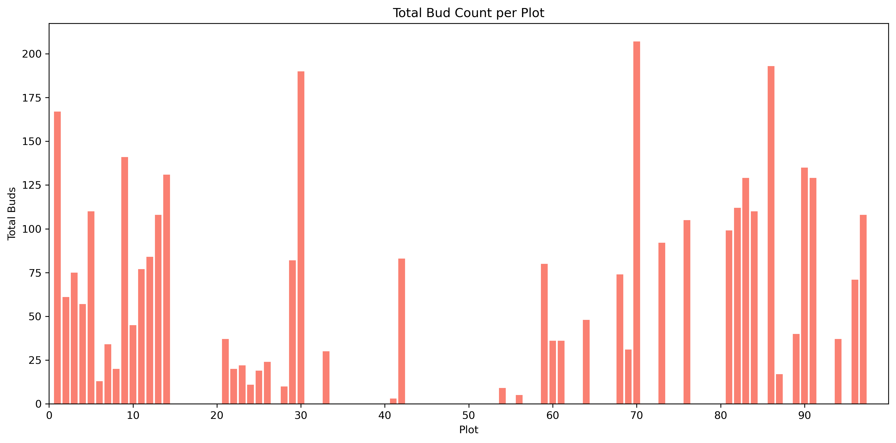
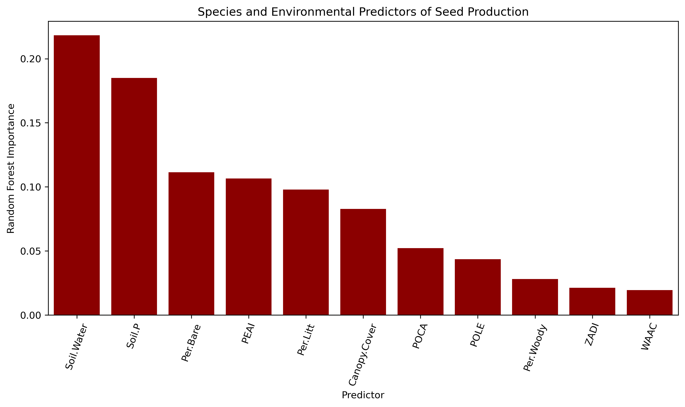
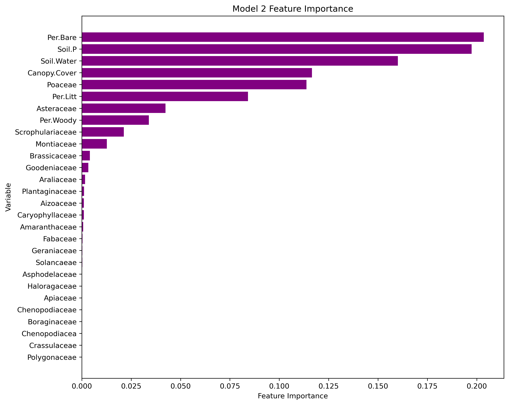
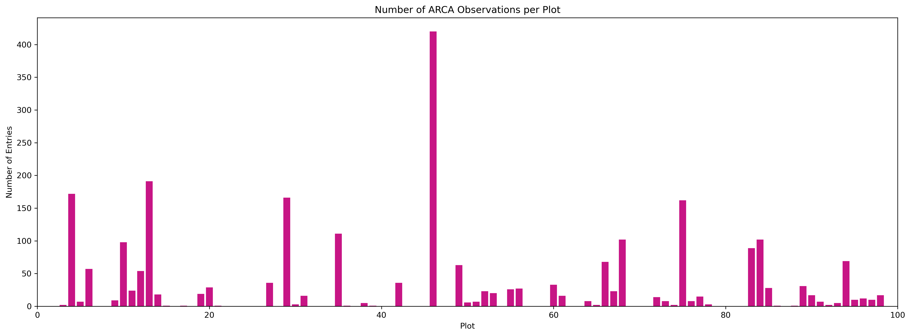
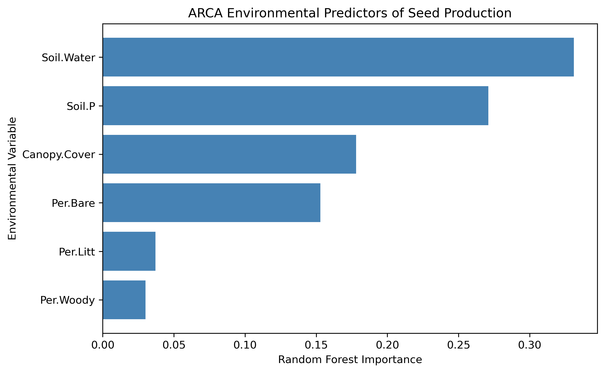
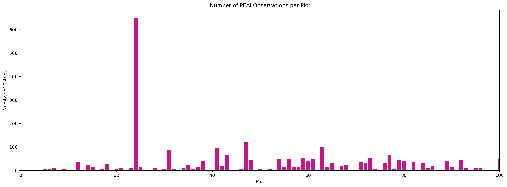

# **Research Log**

**Author:** Kaitlyn Hill  
**Faculty Advisor:** Dr. Trace Martyn  
**Lab:** Martyn Ecology at Oregon State University

---

## **1. Project Overview**

### **1.1 Dissertation Background**

Dr. Martyn’s research examined how plant species interact with each other and their environment. Her work focused on how these interactions influence plant competition, community structure, and reproductive success.

An important part of the dissertation was the study of higher-order interactions. Plant interactions are not always limited to the effects of one species on another. Instead, the presence of additional species can change how two species interact. This means that plant performance may depend on the larger community surrounding an individual.

The datasets collected during this research include information on individual plants, species identity, reproductive output, environmental conditions, and plant locations within plots. These datasets provide several ways to examine the factors associated with plant performance.

The goal of this project was to use these existing datasets in a new way. Rather than repeating the analyses from the dissertation, the project explores new ways to analyze the large quantity of data.

### **1.2 Initial Project Directions**
multiple proposed directions to analyze the dissertation data:

- Spatial / point-pattern analysis: Use mapped plant locations to investigate clustering, competition, neighboring species, and whether spatial relationships were associated with reproductive success.
- Long-term population analysis: Use the long-term seed-bank dataset to examine changes in species abundance and population dynamics over time, potentially using time-series or population-growth models such as Ricker models.
- Machine-learning prediction: Develop a model that uses environmental and biological variables to predict some measure of plant success or reproductive output and identify which variables contribute most strongly to predictions.
- Species interactions and biological groupings: Explore whether species interactions or broader classifications, such as functional or taxonomic groups, could help explain differences in plant performance.

### **1.3 Current Research Direction**
The project currently focuses on using machine-learning approaches to examine patterns in plant reproductive output and determine how well reproductive success can be predicted from environmental and biological characteristics.

The analysis began with bud production as the response variable and environmental conditions as predictors. Limitations identified during this initial analysis led to a transition toward seed production, which provided a substantially larger dataset across more species and plots.

The current modeling framework uses Random Forest regression with plot-grouped cross-validation. Models are being developed iteratively to evaluate different ways of representing biological variation, including species identity and broader species groupings, alongside plot-level environmental conditions.

--- 

## **2. Data**

### **2.1 Individual Trait Data**

**Original file:** `TRAIT.DATA.10.06.2017.csv` 
**Cleaned file:** `buds.csv`  
**Contains:** Individual plant observations, including plot and species identification, reproductive measurements (buds, flowers, and fruits), and plant traits such as height, shape, and phenology.  
**Used For:** Initial exploration of bud production and the first machine-learning model (Model_0)  
**Cleaning performed:**
- Removed observations with missing bud counts.
- Removed all entries that weren’t taken in 2016 (the 2017 entries)
- Removed all POLE species data entries due to insufficient data (only 2 entries)
- Fixed small date entry errors (process date was recorded a decade in the future)
- Began with **1,387** entries, cleaned to **1,270**

### **2.2 Plot Condition Data**

**Original file:** `Plot.DATA.06.09.2017.csv`  
**Cleaned file:** `plots.csv`  
**Contains:** Plot-level environmental, spatial, and community information for the 100 study plots. This includes plot location and identification, vegetation cover, soil phosphorus levels, canopy cover, plant density and diversity, and spatial coordinates/distances.  
**Used for:** Provides the plot-level environmental predictors used in the machine-learning models and can be connected to the biological datasets using their corresponding plot identifiers.  
**Cleaning performed:**
- No needed data cleaning
- The file was renamed for easier identification and use in Python analyses
- **100 entries**, one for each plot

### **2.3 Seed Production Data**

**Original file:** `Plant.Level.Seed.Count.30.6.2018.csv`  
**Cleaned file:** `seeds.csv`  
**Contains:** Individual seed collection observations, including plot and species identification, collection dates, seed counts, reproductive measurements, and data-quality notes.  
**Used for:** Primary biological dataset for the seed-production analysis. Seed number (`Num.Seed`) became the measure of reproductive output after the bud dataset was determined to have insufficient data for the larger machine-learning analysis.  
**Cleaning performed:**
- Removed non-numeric entries such as 'N/A', ' . ', and blank values
- Removed eight unidentified species entries
- Converted relevant variables to numeric values for analysis
- Began with **16,963** entries, cleaned to **13,485**

### **2.4 Species Information Data**

**Original file:** `species_data.csv`  
**Altered file:** `species_data_TEM_2026.csv`  
**Cleaned file:** `species.csv`  
**Contains:** Species-level information, including species name, species code, life form, exotic status, taxonomic family, reserve occurrence, and additional notes  
**Used for:** Providing taxonomic information for Model 2, where species are grouped by taxonomic family to evaluate whether broader taxonomic relationships improve predictions of seed production compared with using individual species identities.  
**Cleaning performed:**
- Known missing taxonomic was placed into a new csv file (`species_data_TEM_2026.csv`)
- All matching values were placed into a new cleaned csv file (`species.csv`) for Model 2

Two assumptions during cleaning:  

---

## **3. Model 0 - Bud Production: Environmental Predictors**

### **3.1 Research Question**
Can plot-level environmental conditions be used to predict bud production at the individual plant level?

The purpose of Model 0 was to establish an initial machine-learning approach for examining whether environmental variation among plots could explain differences in plant reproductive output.

### **3.2 Data Preparation**
Model 0 used individual plant observations from `buds.csv` combined with plot-level environmental data from `plots.csv`. 
 The datasets were joined using: `buds["ID"]` → `plots["Name"]`

The final dataset used for Model 0 contained:
- **1,270 individual plant observations**
- **50 plots**
- **4 species:** ARCA, PEAI, POCA, and VERO
- **Response variable:** `buds`

**Data cleaning note:** An earlier version of the cleaned dataset contained 1,260 observations and produced a mean R² of -0.153. During data review, 10 observations were found to contain incorrect year entries and were restored, resulting in the final dataset of **1,270** observations.

### **3.3 Data Exploration**
Exploratory analysis was conducted to examine species representation and differences in bud production before developing Model 0.

Bud production among the four species:

| Species | Plant Count | Total Buds |Mean Buds per Plant |
| --- | --- | --- | ---: |
| ARCA | 272 | 636 | 2.34 |
| PEAI | 355 | 91 | 0.26 |
| POCA | 329 | 510 |1.55 |
| VERO | 314 | 2320 | 7.39 |

The exploratory results showed substantial differences in bud production among the four species. Although observation counts were relatively similar among the four speciess, total and mean bud production varied considerably among species. This variation suggested that species identity could potentially account for some of the differences in individual reproductive output.

Bud production was also examined across plots where it's production varied considerdably.

### **3.4 Predictors**
Six plot-level environmental variables were selected as predictors:

- `Per.Litt` — percent litter cover
- `Per.Bare` — percent bare ground
- `Per.Woody` — percent woody cover
- `Soil.P` — soil phosphorus
- `Soil.Water` — soil water
- `Canopy.Cover` — canopy cover

Species identity was **not** included as a predictor in Model 0. The purpose of this initial model was to determine how well environmental conditions alone could predict individual bud production.

### **3.5 Model Approach**
A **Random Forest Regressor** was used to predict the number of buds produced by each individual plant.

Model performance was evaluated using **5-fold GroupKFold cross-validation**, with observations grouped by plot. This kept all observations belonging to the same plot within the same fold and prevented the model from being trained and tested on individuals experiencing the same plot-level environmental conditions.

This approach was used to evaluate how well the model could predict bud production in plots that were not included in the training data.

Model performance was evaluated using:

- **R²** — measure of predictive performance relative to predicting the mean, with higher values indicating better model performance
- **MAE** — mean absolute difference between observed and predicted bud counts
- **RMSE** — measure of prediction error that gives greater weight to larger errors

Random Forest feature importance was also used to compare the relative contribution of the six environmental predictors.

### **3.6 Results**

| Model Performance | |
| --- | ---:|
| Mean R² | -0.052 |
| Mean MAE | 3.13 buds |
| Mean RMSE | 4.98 buds |

The negative mean R² (-0.052) indicates that the model performed poorly when predicting bud production in unseen plots and did not outperform a simple baseline prediction based on the mean. Across cross-validation folds, predictions differed from observed bud counts by an average of approximately 3.13 buds (MAE), while the RMSE of 4.98 buds indicates that larger prediction errors were also present.

#### Feature importance

| Variable | Importance |
| --- | ---: |
| Soil.P | 0.270 |
| Per.Bare | 0.223 |
| Per.Woody | 0.199 |
| Canopy.Cover | 0.134 |
| Soil.Water | 0.122 |
| Per.Litt | 0.051 |

Soil phosphorus had the highest feature importance (0.270), followed by percent bare ground (0.223) and percent woody cover (0.199). Together, these variables contributed the most to the Random Forest model’s predictions of bud production. Canopy cover (0.134) and soil water (0.122) showed moderate importance, while percent litter cover had the lowest feature importance (0.051). Overall, the model relied more heavily on soil phosphorus and ground-cover characteristics than on the other environmental predictors.

### **3.7 Interpretation**
Overall, Model 0 had poor predictive performance. The negative mean R² indicates that the six environmental predictors alone were not sufficient to accurately predict individual bud production in plots excluded from model training.

Although soil phosphorus, percent bare ground, and percent woody cover had the highest feature importance values, these values should be interpreted cautiously because of the model's poor overall predictive performance. Feature importance identifies which variables the Random Forest relied on most when making predictions, but does not necessarily indicate that those variables have strong ecological effects on bud production.

The exploratory analysis also showed considerable differences in bud production among species. Because species identity was not included as a predictor in Model 0, some of the unexplained variation in bud production may be associated with differences among species rather than the measured environmental conditions alone.

### **3.8 Discussion / Next Steps**
Model 0 established an initial framework for predicting reproductive output from plot-level environmental conditions. However, its results also highlighted several limitations of the bud dataset that affected the direction of subsequent models.

Several limitations were identified:

- The bud dataset contained only **1,270** usable observations across **50 plots**.
- Only four species were sufficiently represented in the dataset.
- Bud production varied substantially among species, but species identity was not included in Model 0.
- The environmental predictors alone were not sufficient to accurately predict bud production in unseen plots.

Given the observed differences in bud production among species, incorporating species identity as an additional predictor was considered the logical next step for improving Model 0. This would have allowed the model to account for species-level differences in reproductive output rather than relying solely on environmental conditions. However, the relatively small number of observations, limited species representation, and coverage of only 50 plots restricted the amount of information available for developing and evaluating a more complex species-inclusive bud model. As a result, this extension was considered but was not pursued further with the bud dataset.

A larger seed-production dataset (`seeds.csv`) was available that contained substantially more observations, represented more species, and covered all 100 plots. Seed production also provided an alternative measure of reproductive output that could be analyzed using the same general machine-learning framework.

Based on these limitations, the project shifted from bud production to seed production as the primary response variable. The next model, Model 1, used `Num.Seed` as the response and expanded the predictor set to include species identity alongside the environmental variables. This transition allowed the analysis to test whether accounting for differences among species could improve predictions of reproductive output while retaining the environmental predictors examined in Model 0.

---

## **4. Model 1 - Seed Production**

### **4.1 Research Question**
Can seed production at the individual observation level be predicted using species identity and plot-level environmental conditions?

Model 1 applies the machine-learning framework established in Model 0 to the larger seed-production dataset. Unlike Model 0, which examined bud production, Model 1 uses seed production as the response variable and incorporates species identity alongside plot-level environmental predictors

### **4.2 Data Preparation**
Model 1 used seed-production data from `seeds.csv` and plot-level environmental data from `plots.csv`. 
 The seed and plot datasets were joined using: `seeds["Plot.ID"]` → `plots["Plot"]`

The response variable was:
- `Num.Seed` - Number of seeds recorded for an observation

The final dataset used for Model 1 contained:

- **13,485 observations**
- **100 plots**
- **70 species**

### **4.3 Data Exploration**

Exploratory analysis examined species representation and differences in seed production before developing Model 1.

#### Overall Seed Distribution
Seed production was highly variable across the dataset.

| Statistic | Seeds |
| --- | ---: |
| Mean | 64.12 |
| Standard Deviation | 173.62 |
| Minimum | 0 |
| 25th Percentile | 7 |
| Median | 20 |
| 75th Percentile | 52 |
| Maximum | 5,830 |

The mean seed count (64.12) was substantially greater than the median (20), and the maximum observation reached 5,830 seeds. This indicates a strongly right-skewed distribution in which most observations had relatively low seed counts while a smaller number of observations had very high seed production.

A total of **1,014 observations (7.52%)** recorded zero seeds.
Total seed production was also examined across plots:

Total seed production varied substantially among plots, with several plots producing considerably more seeds than others. This variation provided an initial indication that seed production was unevenly distributed across the study plots.

Because 70 species were represented in the modeling dataset, the seven most frequently observed species are summarized below:

| Species | Observations | Total Seeds | Mean Seeds | Median Seeds | Std | Min Seeds | Max Seeds |
| --- | --- | --- | --- | --- | --- | --- | ---: |
| VERO | 3027 | 55915 | 18.47 | 14.0 | 20.12 | 0 | 184 |
| ARCA | 2515 | 88710 | 35.27 | 15.0 | 84.07 | 0 | 1386 |
| PEAI | 2485 | 372236 | 149.79 | 60.0 | 281.32 | 0 | 5830 |
| POCA | 943 | 134647 | 142.79 | 73.0 | 213.55 | 0 | 2480 |
| PLDE | 478 | 19107 | 39.97 | 32.0 | 35.31 | 0 | 238 |
| PTGA | 465 | 9137 | 19.65 | 12.0 | 25.06 | 0 | 192 |
| HYGL | 376 | 9258 | 24.62 | 15.0 | 38.67 | 0 | 387 |

VERO, ARCA, and PEAI were particularly well represented, with more than 2,400 observations each. In contrast, many species had relatively few observations, including several species represented by only one or two observations.

Seed production also differed substantially among species. For example, PEAI averaged **149.79 seeds per observation**, while VERO averaged **18.47** despite having the largest number of observations. POCA also had relatively high seed production, averaging **142.79 seeds** per observation. These differences in seed production among species suggested that species identity could account for some of the variation not captured by plot-level environmental conditions alone..

### **4.4 Predictors**
Model 1 included both biological and environmental predictors.

Species identity was included as a categorical predictor:

- `Species`

The same six plot-level environmental predictors examined in Model 0 were retained:

- `Per.Litt` - Percent litter cover
- `Per.Bare` - Percent bare ground
- `Per.Woody` - Percent woody cover
- `Soil.P` - Soil phosphorus
- `Soil.Water` - Soil water
- `Canopy.Cover` - Canopy cover

Because species identity is categorical, it was one-hot encoded into separate species-specific predictor variables for use in the Random Forest model.

### **4.5 Model Approach**
A **Random Forest Regressor** was used to predict `Num.Seed` using species identity and the six environmental predictors.

Model performance was evaluated using **5-fold GroupKFold cross-validation**, with observations grouped by plot. All observations from the same plot were therefore kept within the same fold. This allowed model performance to be evaluated on plots that were not included in the corresponding training data.

Performance was evaluated using:
- **R²** — proportion of variation in seed production explained by the model
- **MAE** — mean absolute difference between observed and predicted seed counts
- **RMSE** — measure of prediction error that gives greater weight to larger errors

Random Forest feature importance was also calculated to examine the relative contribution of species identity and environmental conditions to model predictions.

### **4.6 Results**

#### Model Performance

| Metric | Value |
| --- | ---: |
| Mean R² | -0.012 |
| Mean MAE | 76.28 seeds |
| Mean RMSE | 172.18 seeds |

The mean R² was close to zero but remained negative, indicating that the model had poor predictive performance when predicting seed production in unseen plots.

The RMSE was substantially larger than the MAE, indicating that some observations had particularly large prediction errors.

#### Feature Importance
The Random Forest model contained **76 predictors** after species identity was encoded alongside the six environmental variables.

The highest-ranking predictors included:

| Variable | Importance |
| --- | ---: |
| Soil.Water | 0.218 |
| Soil.P | 0.185 |
| Per.Bare | 0.111 |
| PEAI | 0.107 |
| Per.Litt | 0.098 |

Soil water had the highest feature importance, followed by soil phosphorus. `PEAI` was the highest-ranking species-specific predictor and was the fourth most important predictor overall.

Some species-specific predictors contributed very little to the model. Among the lowest feature importance values were `ERLO`, `AVBA`, `GR.HUGE`, `PTGA.YEL`, and `EMAU`.

For visualization clarity, only predictors with a Random Forest feature importance greater than 0.015 are displayed.

### **4.7 Interpretation**
Model 1 had limited predictive ability, with a mean R² of -0.012. The negative R² indicates that the model did not generalize well when predicting seed production in unseen plots.

The large difference between the MAE and RMSE suggests that some observations had particularly large prediction errors. This is consistent with the wide range in seed production, which extended from 0 to 5,830 seeds.

Species identity also contributed to model predictions, with Species_PEAI ranking as the highest species-specific predictor and fourth-highest predictor overall. However, species representation within the dataset was highly uneven. Some species contained substantially more observations than others, which may influence the contribution of individual species variables to the model.

The feature importance results also suggest that environmental conditions remained relevant to model predictions. Soil water and soil phosphorus were the two highest-ranking predictors. However, because overall predictive performance remained poor, feature importance should be interpreted cautiously and should not be considered evidence of direct ecological effects.

### **4.8 Discussion / Next Steps**
Although adding species identity provided more biological information than Model 0, Model 1 still had limited predictive ability. The model also introduced a new challenge: representing a large number of individual species as separate predictors.

With 70 species represented in the dataset, species differed considerably in the number of available observations and in their seed production. Treating every species independently may therefore create a large number of species-specific predictors without capturing biological similarities among them.

Potential next steps included exploring alternative ways to represent species-level variation. These included:

- Grouping species according to broader biological or taxonomic characteristics
- Examining species diversity and composition within plots
- Exploring species-level effect sizes relative to typical seed production
- Focusing additional analyses on selected species with sufficient representation and known ecological characteristics

The next model therefore investigates whether species can be represented using broader biological groupings rather than treating each species as completely independent.

---

## **5. Model 2 — Seed Production: Family Groups + Environment**

### **5.1 Research Question**

Can seed production at the individual observation level be predicted using taxonomic family and plot-level environmental conditions?

Model 2 builds on Model 1 by replacing individual species identity with broader taxonomic family groups. Model 1 represented each of the 70 species as an independent categorical predictor, while Model 2 groups species that belong to the same taxonomic family. This approach investigates whether broader taxonomic relationships can represent biological variation in seed production while reducing the number of categorical predictors included in the model.

### **5.2 Data**

Model 2 used seed-production data from `seeds.csv`, taxonomic information from `species.csv`, and plot-level environmental data from `plots.csv`.

Species information was matched to the species represented in the seed-production dataset during previous data preparation. Known differences in species identifiers between the original seed and species-information datasets were standardized before creation of `species.csv`.

One unidentified species code, `UK.GRASS`, did not have corresponding taxonomic information and was excluded from Model 2. This resulted in the removal of 4 observations from the Model 1 dataset.

The seed and species datasets were joined using: 
`seeds["Species"]` → `species["Species"]`

The seed and plot datasets were joined using:  
`seeds["Plot.ID"]` → `plots["Plot"]`

The response variable was:
- `Num.Seed` - Number of seeds recorded for an observation

The final dataset used for Model 2 contained:

- **13,481 observations**
- **100 plots**
- **22 taxonomic families**

### **5.3 Predictors**

Model 2 included both taxonomic and environmental predictors.

Taxonomic family was included as a categorical predictor:  
- `family`

The same six plot-level environmental predictors examined in Models 0 and 1 were retained:

- `Per.Litt` - Percent litter cover
- `Per.Bare` - Percent bare ground
- `Per.Woody` - Percent woody cover
- `Soil.P` - Soil phosphorus
- `Soil.Water` - Soil water
- `Canopy.Cover` - Canopy cover

Because taxonomic family is categorical, it was one-hot encoded into separate family-specific predictor variables for use in the Random Forest model.

After one-hot encoding, the model contained **28 predictors**: 22 family-level predictors and six environmental predictors.

### **5.4 Model Approach**

A **Random Forest Regressor** was used to predict `Num.Seed` using taxonomic family and the six environmental predictors.

The modeling framework was kept consistent with Model 1 so that the effect of changing the biological grouping could be evaluated while maintaining the same general modeling approach.

Model performance was evaluated using **5-fold GroupKFold cross-validation**, with observations grouped by plot. All observations from the same plot were therefore kept within the same fold. This allowed model performance to be evaluated on plots that were not included in the corresponding training data.

Performance was evaluated using:

- **R²** — proportion of variation in seed production explained by the model
- **MAE** — mean absolute difference between observed and predicted seed counts
- **RMSE** — measure of prediction error that gives greater weight to larger errors

Random Forest feature importance was also calculated and averaged across the cross-validation folds to examine the relative contribution of taxonomic family and environmental conditions to model predictions.

Because the response variable, environmental predictors, modeling algorithm, and cross-validation strategy were kept consistent with Model 1, Model 2 provides a direct comparison between representing biological variation using individual species and broader taxonomic families.

### **5.5 Results**

| Metric | Value |
| --- | ---: |
| Mean R² | -0.153 |
| Mean MAE | 83.29 seeds |
| Mean RMSE | 182.92 seeds |

The mean R² was negative, indicating that Model 2 had poor predictive performance when predicting seed production in unseen plots.

The RMSE was substantially larger than the MAE, indicating that some observations had particularly large prediction errors. This pattern was also observed in Model 1 and is consistent with the highly variable and right-skewed distribution of seed production.

#### **Feature Importance**

The Random Forest model contained **28 predictors** after the 22 taxonomic families were encoded alongside the six environmental variables.

The highest-ranking predictors included:

| Variable | Importance |
| --- | ---: |
| Per.Bare | 0.204 |
| Soil.P | 0.197 |
| Soil.Water | 0.160 |
| Canopy.Cover | 0.117 |
| Poaceae | 0.114 |
| Per.Litt | 0.084 |
| Asteraceae | 0.042 |
| Per.Woody | 0.034 |

Environmental variables accounted for most of the highest-ranking predictors. Percent bare ground had the highest feature importance, followed by soil phosphorus and soil water.

`Poaceae` was the highest-ranking family-level predictor and the fifth most important predictor overall, with a feature importance of 0.114. `Asteraceae` was the next highest-ranking family at 0.042. Most other family-level predictors had substantially lower feature importance.

### **5.6 Interpretation**

Model 2 had poor predictive performance, with a mean R² of -0.153. Performance was also worse than Model 1, which had a mean R² of -0.012. This suggests that grouping species by taxonomic family did not improve the model's ability to predict seed production in unseen plots.

Environmental variables remained the highest-ranking predictors, particularly percent bare ground, soil phosphorus, and soil water. Poaceae was the highest-ranking family predictor, while most other families had relatively low feature importance.

Grouping species by family may remove important differences among individual species. Although species within the same family are taxonomically related, they may still differ substantially in seed production and their responses to environmental conditions.

### **5.7 Decisions / Next Steps**

Model 2 reduced the number of biological categories from 70 species to 22 families, but this simplification did not improve predictive performance. Grouping species into broader taxonomic categories may have removed some of the species-level differences that are important for understanding variation in seed production.

The results from Models 1 and 2 suggest that combining many species within a single model may not be the most effective approach. Species vary considerably in both their number of observations and their seed production, which may make it difficult for a single model to represent these differences.

Model 3 will therefore focus on the most frequently recorded species and model each species separately. Prioritizing species with the largest number of observations will provide more data for training and evaluating each species-specific model.

This approach will remove differences among species from within each model and allow Model 3 to focus specifically on whether plot-level environmental conditions can predict variation in seed production within individual species. Model performance and feature importance can then be compared across the selected species.

---

## **6. Model 3 — Seed Production: Individual Species**

### **6.1 Research Question**
Can plot-level environmental conditions better predict seed production when models are restricted to individual, well-represented species?

Model 3 investigates seed production separately within individual species. By removing variation associated with species identity, these models examine whether environmental conditions can predict seed production more effectively within a single species. The models also allow environmental feature importance to be compared across species.

The analysis was conducted using four species-specific models. **Model 3a** focused on **VERO**, the most frequently represented species in the seed dataset and an original focus of the dissertation. The same modeling approach was then independently applied to **ARCA (Model 3b), PEAI (Model 3c), and POCA (Model 3d)**. These were the next three most frequently represented species in the dataset.

Model 3 is framed to investigate two questions:
1. How well does the Random Forest predict seed production for each species?
2. Does the relative importance of environmental predictors differ among VERO, ARCA, PEAI, and POCA?

### **6.2 Data**
Model 3 used the same cleaned seed-production and plot-level environmental datasets used for Model 1.

The response variable remained:

- `Num.Seed` — number of seeds recorded for an observation

The expanded analysis included separate models for the four most frequently represented species:

| Species | Observations | Number of Plots | 
| --- | --- | ---: |
| VERO | 3,027 | 46 |
| ARCA | 2,515 | 61 |
| PEAI | 2,485 | 74 |
| POCA | 943 | 71 |

Together, these four species accounted for 8,970 of the 13,485 observations in the full seed dataset.

Restricting the analysis to these species allowed environmental relationships to be examined within individual species while retaining substantially larger sample sizes than were available for most other species in the dataset.

### **6.3 Predictors**
Model 3 used the same six plot-level environmental predictors examined in Models 0 and 1:

- `Per.Litt` — percent litter cover
- `Per.Bare` — percent bare ground
- `Per.Woody` — percent woody cover
- `Soil.P` — soil phosphorus
- `Soil.Water` — soil water
- `Canopy.Cover` — canopy cover

Species identity was not included as a predictor because each model was restricted to observations from a single species. This allowed Model 3 to focus specifically on whether variation in environmental conditions could explain differences in seed production within each species.

### **6.4 Model Approach**
A **Random Forest Regressor** was used to predict `Num.Seed` from the six environmental predictors.

Four separate models were created for the selected species:
- Model 3a — VERO
- Model 3b — ARCA
- Model 3c — PEAI
- Model 3d — POCA

Each species was modeled independently using the same environmental predictors and modeling procedure.

Model performance was evaluated using **5-fold GroupKFold cross-validation**, with observations grouped by plot. This ensured that observations from the same plot were kept together during training and testing.

Model performance was evaluated using:

- **R²** — proportion of variation in seed production explained by the model
- **MAE** — mean absolute difference between observed and predicted seed counts
- **RMSE** — measure of prediction error that gives greater weight to larger errors

Random Forest feature importance was also calculated separately for each species. This allowed both model performance and the relative importance of environmental predictors to be compared among VERO, ARCA, PEAI, and POCA.

### **6.5 Results**

#### **6.5.1 Model 3a - VERO**

VERO was represented by **3,027 observations across 46 plots**. However, observations were unevenly distributed among plots, with several plots containing substantially more VERO observations than others.

Total VERO seed production also varied considerably among plots. Plots with greater numbers of VERO observations generally contributed larger total seed counts, although the relationship was not uniform. This suggests that differences in total seed production among plots reflect both variation in the number of sampled plants and variation in seed production among individual plants.

#### Model Performance

| Metric | Value |
| --- | ---: |
| Mean R² | -0.366 |
| Mean MAE | 18.13 seeds |
| Mean RMSE | 22.92 seeds |

The VERO-specific Random Forest showed poor predictive performance. The mean cross-validated R² was **−0.366**, indicating that predictions on held-out plots performed worse than a simple baseline based on the mean seed count. The model had a mean absolute error of **18.13 seeds** and a root mean squared error of **22.92 seeds**.

These results suggest that the six plot-level environmental variables included in the model were not sufficient to reliably predict individual VERO seed production across plots.

#### Feature importance

| Variable | Importance |
| --- | ---: |
| Canopy.Cover | 0.545 |
| Soil.Water | 0.156 |
| Per.Litt | 0.095 |
| Soil.P | 0.087 |
| Per.Bare | 0.079 |
| Per.Woody | 0.038 |

Canopy cover had the greatest feature importance (0.545), accounting for more than half of the total Random Forest importance. Soil water was the second most important predictor (0.156), while the remaining environmental variables had substantially lower importance values.

The importance values indicate which variables the Random Forest relied on most when making predictions, but they do not demonstrate that those variables successfully predicted VERO seed production on previously unseen plots.

**Investigate outlier data and insert here**

#### **6.5.2 Model 3b - ARCA**

ARCA was well represented across the dataset, but observations were unevenly distributed among plots. Several plots contained relatively large numbers of ARCA observations, while many others contained only a small number.

Total ARCA seed production also varied substantially among plots. Some plots produced several thousand seeds, while others contributed comparatively little. As with VERO, differences in total seed production among plots likely reflect both the number of ARCA observations within each plot and variation in seed production among individual plants.

#### Model Performance

| Metric | Value |
| --- | ---: |
| Mean R² | -0.732 |
| Mean MAE | 69.87 seeds |
| Mean RMSE | 99.34 seeds |

The ARCA-specific Random Forest showed poor predictive performance. The mean cross-validated R² was **−0.732**, indicating that predictions on held-out plots performed substantially worse than a simple baseline based on the mean seed count.

The mean absolute error was **69.87 seeds**, while the root mean squared error was **99.34 seeds**. The larger RMSE relative to MAE suggests that some prediction errors were particularly large.

#### Feature importance

| Variable | Importance |
| --- | ---: |
| Soil.Water | 0.331 |
| Soil.P | 0.271 |
| Canopy.Cover | 0.178 |
| Per.Bare | 0.153 |
| Per.Litt | 0.037 |
| Per.Woody | 0.030 |

Soil water had the greatest feature importance (0.331), followed by soil phosphorus (0.271). Canopy cover (0.178) and percent bare ground (0.153) also contributed meaningfully to the model, while percent litter and percent woody cover had relatively low importance.

Although soil water and soil phosphorus were the most influential predictors within the fitted Random Forest, these importance values should be interpreted cautiously because overall predictive performance was poor. The negative cross-validated R² indicates that the model did not generalize well to unseen plots.

**Investigate outlier data and insert here**

#### **6.5.3 Model 3c - PEAI**

PEAI observations were distributed across many plots, although sampling was highly uneven. Plot 24 contained substantially more observations than any other plot.

**Note data collection**

Seed production showed even greater variation across plots. Several plots produced more than 20,000 total seeds, while many produced fewer than 5,000. Notably, the plots with the greatest seed production were not necessarily those with the largest numbers of observations, suggesting substantial differences in seed production per observation.

Model 3c produced a mean cross-validated R² of **−0.591**, indicating poor predictive performance on held-out plots. Prediction errors were also relatively large, with a mean MAE of **154.67 seeds** and RMSE of **265.22 seeds**.

The substantial difference between MAE and RMSE is consistent with the large variation in PEAI seed production, as particularly large prediction errors have a greater effect on RMSE.

#### Model Performance

| Metric | Value |
| --- | ---: |
| Mean R² | -0.591 |
| Mean MAE | 154.67 seeds |
| Mean RMSE | 265.22 seeds |

Unlike VERO, no single environmental variable overwhelmingly dominated the PEAI model. Soil phosphorus had the highest importance (0.298), followed by soil water (0.253) and percent litter (0.223). Together, these three variables accounted for most of the model's feature importance.

#### Feature importance

| Variable | Importance |
| --- | ---: |
| Soil.P | 0.298 |
| Soil.Water | 0.253 |
| Per.Litt | 0.223 |
| Per.Bare | 0.146 |
| Canopy.Cover | 0.049 |
| Per.Woody | 0.031 |

Despite these differences in relative importance, the negative R² indicates that the environmental predictors did not generalize well enough to reliably predict PEAI seed production across unseen plots. The high variability in PEAI seed counts may have contributed to the model's difficulty in producing accurate predictions.

**Investigate outlier data and insert here**  
PEAI has the most outliers, assumed to be due to data collection (especially on plot 24).

#### **6.5.4 Model 3d - POCA**

POCA observations were spread across multiple portions of the study plots, with higher concentrations occurring in several plots in the 80–100 range. Compared with PEAI, no single plot overwhelmingly dominated the number of observations.

Total POCA seed production varied considerably across these plots. Most plots produced fewer than 5,000 total seeds, while a small number had substantially greater production. In particular, one plot exceeded 10,000 total seeds despite not having the greatest number of POCA observations.

#### Model Performance

| Metric | Value |
| --- | ---: |
| Mean R² | -0.321 |
| Mean MAE | 174.48 seeds |
| Mean RMSE | 241.36 seeds |

Model 3d had a mean cross-validated R² of **−0.321**. Although this was the least negative R² among the four species-specific models, performance remained below the baseline represented by an R² of zero.

The model produced an MAE of **174.48 seeds** and an RMSE of **241.36 seeds**. These relatively large errors reflect the difficulty of predicting the substantial variation in individual POCA seed counts using the environmental variables available.

#### Feature importance

| Variable | Importance |
| --- | ---: |
| Soil.P | 0.303 |
| Canopy.Cover | 0.237 |
| Per.Litt | 0.152 |
| Soil.Water | 0.143 |
| Per.Bare | 0.092 |
| Per.Woody | 0.074 |

Soil phosphorus was the highest-ranked predictor for POCA (0.303), followed by canopy cover (0.237). Percent litter and soil water had intermediate importance, while percent bare ground and percent woody cover contributed less to the fitted model.

**Investigate outlier data and insert here**

#### **6.5.5 Comparison Across Species**

#### Feature importance

| Species| Observations | Plots | R² | MAE | RMSE |
| --- |--- |--- |--- |--- | ---: |
| VERO | 3027 | 46 | -0.366 | 18.13 | 22.92 |
| ARCE | 2515 | 61 | -0.732 | 69.87 | 99.35 |
| PEAI | 2485 | 74 | -0.591 | 154.67 | 265.22 |
| POCA | 943 | 71 | -0.321 | 174.48 | 241.36 |

### **6.6 Interpretation**
### **6.7 Decisions / Next Steps**

---

